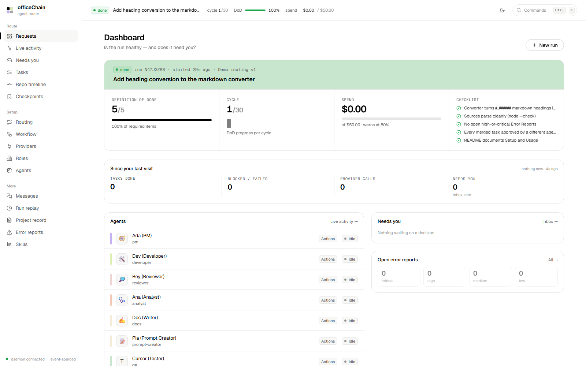
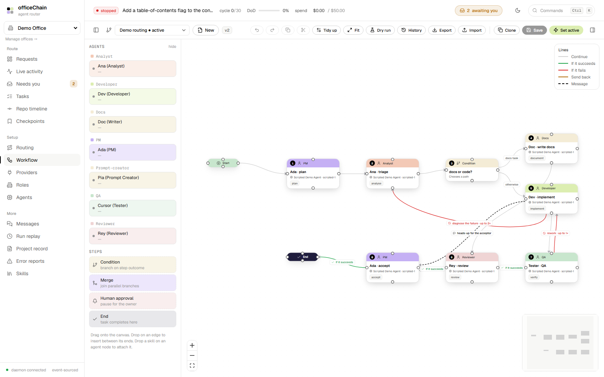
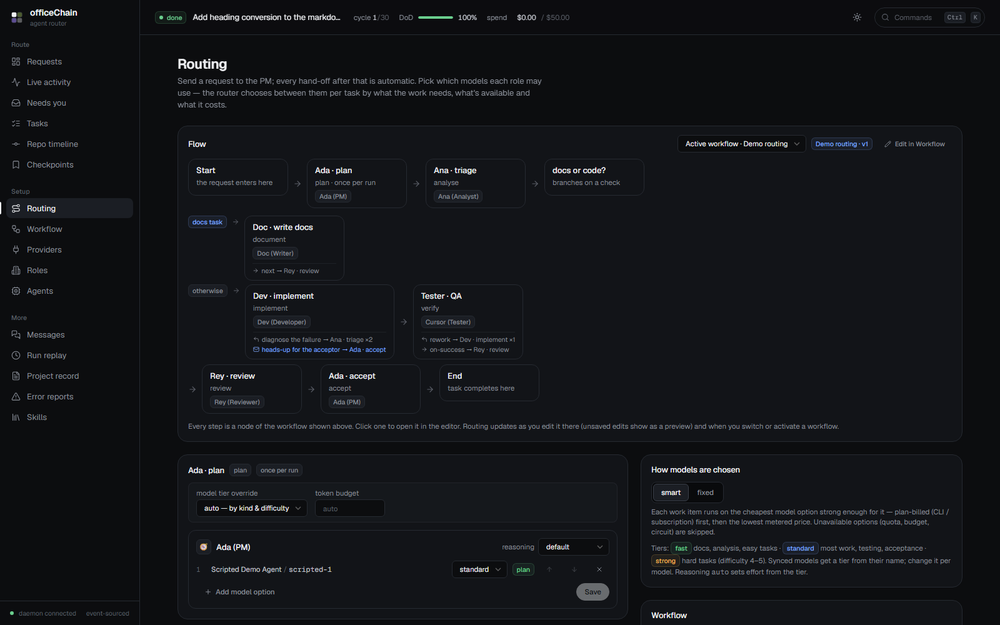
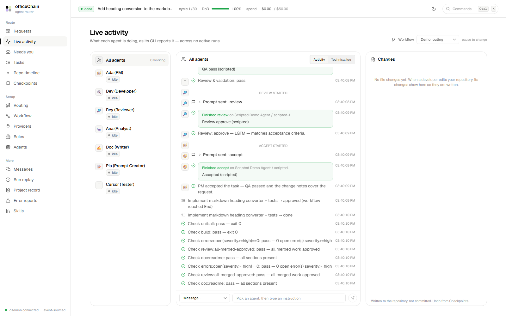
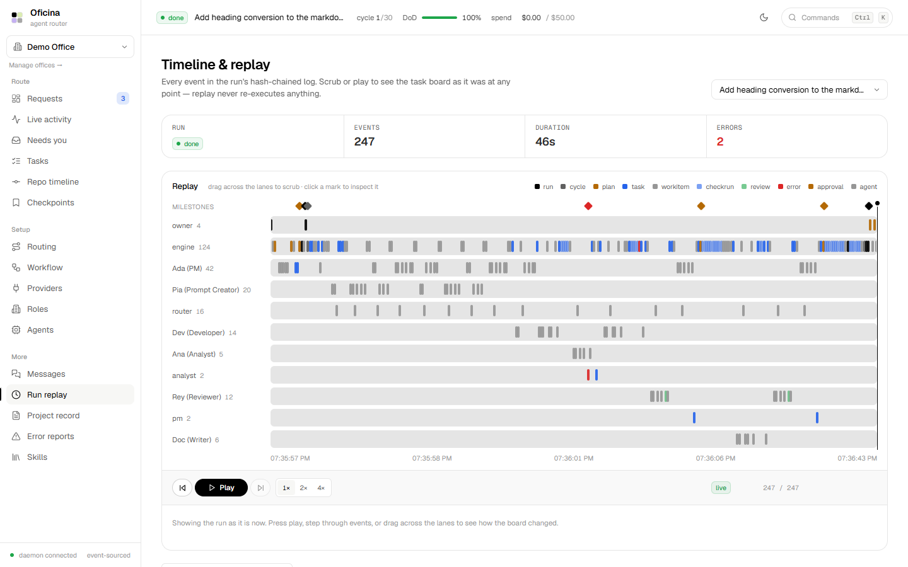
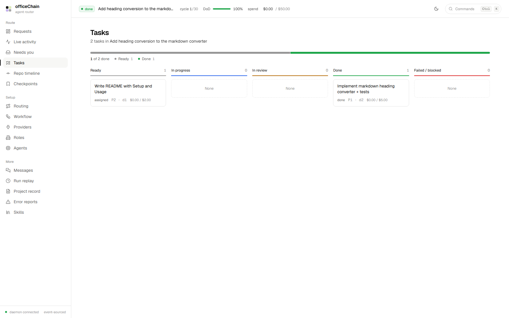
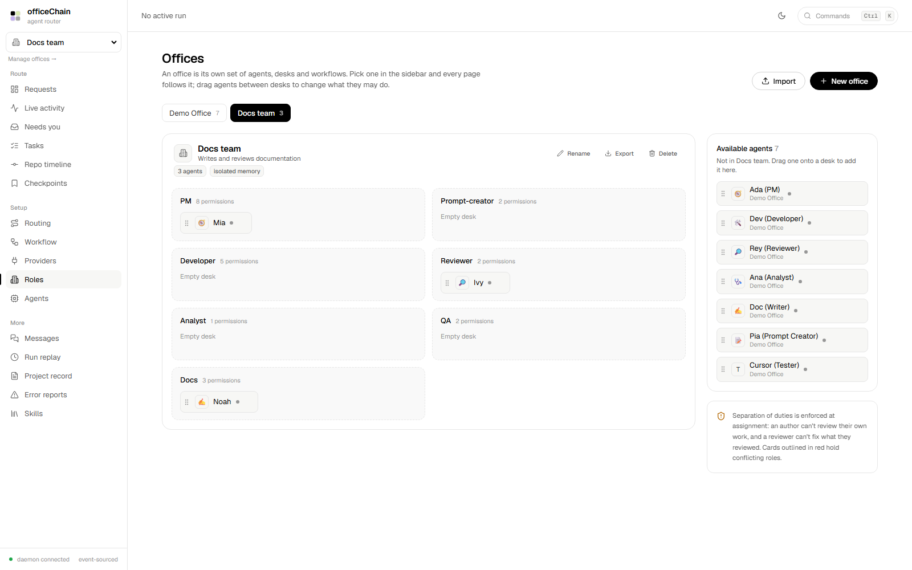
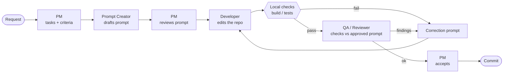

<div align="center">

# officeChain

**A local-first AI agent router — a deterministic workflow engine runs the build loop, AI agents do the work inside it.**




</div>

> Screenshots in this README were captured from a real local instance running the bundled **scripted demo agents** (no model calls, no cost), so the activity and task data come from the demo run rather than a production workload.

---

## Overview

Most agent tools let a model decide what happens next. officeChain inverts that: **the engine owns the loop, the agents own the judgement.** A goal is turned into a *Definition of Done* — a checklist of machine-checkable criteria — and the engine repeats plan → assign → build → verify → review → merge until every check passes or a limit stops it. Git and a local verification runner are the ground truth; "done" is measured, never self-reported by a model.

Because the engine is deterministic and event-sourced, every agent — including the PM — is replaceable, runs are replayable, and loops are bounded instead of spinning forever.

## Features

| | |
|---|---|
| **Deterministic workflow engine** | A durable state machine drives the loop. Agents are called at defined decision points; loops are bounded (3 attempts, then you decide). |
| **Definition of Done** | Acceptance criteria map to checks: commands that must `exit 0`, zero open high/critical error reports, reviews approved by a *different* agent, required README sections, and more. |
| **Visual workflow editor** | Edit the pipeline as a graph (agent, condition, merge, human and end nodes; success/failure/reject/message edges). Validate, dry-run with no model calls, version, clone and activate it — or pick a workflow per request. |
| **Multiple offices** | Each office is its own set of agents, desks and workflows. Create one blank or by copying another, switch from the sidebar, and every page follows the choice. Export or import a whole office, or a single workflow, as portable JSON. |
| **Smart model routing** | Per work item, picks the cheapest model option strong enough for the job — plan-billed CLI logins first, then lowest metered price — with circuit breakers, quota windows, budgets and failover. |
| **Bring your own backend** | Claude Code, cursor-agent and Devin CLIs (their own logins), Devin's cloud API, OpenAI-compatible APIs (OpenAI, Ollama, LM Studio), the Anthropic API, or a scripted demo agent. |
| **Works in your repository** | Agents edit your checked-out branch like a coding CLI. Your uncommitted changes are preserved; the office never runs `reset`, `checkout`, `clean` or force-push. |
| **Checkpoints, undo & redo** | Task- and agent-level checkpoints stored as git tree objects. Undo/redo/restore apply a patch after a dry run — no model is called. |
| **Typed hand-offs** | Agents pass structured envelopes (summary, files changed, checks run, open questions, blockers) instead of whole outputs; decision roles answer in validated JSON with one repair retry. |
| **Separation of duties** | An author can't review their own work, and the UI shows which permissions change before you move an agent between roles. |
| **Observable & replayable** | Live per-agent activity parsed locally from CLI output, plus a hash-chained event log you can scrub through to replay a run's task board. |
| **Human in the loop** | Approval modes (`always-ask`, `ask-when-risky`, `auto`), a "Needs you" inbox, spend and time ceilings that pause rather than kill, and tray notifications on Windows. |

## Screenshots

### Workflow editor
Build or clone a pipeline as a graph; the palette on the left lists only the open office's agents, colored by role to match the nodes it creates. Export saves a flow as a file any office can import. While a run of the open workflow is ongoing, node rings and taken edges show its progress live; finished runs are replayed under Run replay, so an idle workflow shows as a plain graph.



### Routing
The flow is derived from the saved active workflow and reads top to bottom: numbered steps colored by role, branch lanes with their conditions, and loop, send-back and message links on each step. Per-node model tier and budget overrides sit below it.



### Live activity
What each agent's CLI reports — prompts, messages, checks and hand-offs — with no extra model calls.



### Timeline & replay
Every event in the run's hash-chained log, by actor lane. Scrub or play the playhead to see the task board as it was at any point; replay never re-executes anything.



### Tasks
The run's tasks by state, with an overall progress bar.



### Offices
Create, copy, rename, export and import offices; the sidebar switcher scopes the rest of the app to one. Only that office's agents are on its desks, and agents from other offices can be dragged in. Dragging an agent to a desk shows the permission change before anything happens.



## How it works



| Step | Role | Does | Never |
|---|---|---|---|
| 1 | `pm` | turns the request into tasks and acceptance criteria | write, review or test code |
| 2 | `prompt-creator` | drafts the implementation-ready prompt | — |
| 3 | `pm` | reviews the draft — approves it or sends it back | — |
| 4 | `developer` | edits the repository, self-checks, writes change notes | — |
| 5 | `qa` / `reviewer` | checks the work against the approved prompt, criteria and tests | edit code |
| 6 | `pm` | accepts (→ commit per policy) or reworks via a correction prompt | read code |

This is the default pipeline. The **Workflow** page can replace it with your own graph; with no custom workflow active, the flow above is unchanged. The PM runs only when a decision is needed, not continuously.

**Design principles**

- **Engine owns the loop.** If a provider fails, the engine fails over to another option or pauses only the affected work.
- **Done is measured.** Check results come from a deterministic verification service, never a model's opinion.
- **Git is the hand-off surface.** Commits contain only the task's own files, and your hooks, signing and identity apply.
- **Local by default.** The daemon listens on `127.0.0.1`; state lives in a local SQLite database.

The full design rationale is in [`spec/AI-Agent-Office-Spec.md`](spec/AI-Agent-Office-Spec.md), and the behaviour of each subsystem is documented in the [detailed guide](docs/guide.md).

## Getting started

### Prerequisites

- **Node.js 22.5 or newer** — the daemon uses the built-in `node:sqlite` module (declared in `package.json` `engines`).
- **npm** (workspaces are used; no other package manager is configured).
- **Git** on your `PATH` — agents work in git repositories.
- *Optional:* a coding-agent CLI (`claude`, `agent`/cursor-agent, `devin`), a Devin API key, an OpenAI-compatible endpoint such as [Ollama](https://ollama.com), or an Anthropic API key. The bundled scripted agents need none of these.

> Developed and tested on Windows 11. The `.bat`/tray launchers are Windows-only; the npm scripts are plain Node, but other platforms have not been verified.

### Install and run

```bash
git clone <this-repository-url>
cd officeChain

npm install
npm run build -w ui     # builds the React UI into ui/dist
npm run dev             # starts the daemon on http://localhost:4780
```

Open <http://localhost:4780>. On first start the daemon seeds a **Demo Office** workspace with five scripted agents (PM, Developer, Reviewer, Analyst, Docs) and creates a small demo git repository at `demo-repo/`.

### Try the demo run

1. On the Dashboard, start a **New run** with a goal.
2. Approve the Definition of Done in the **Needs you** inbox.
3. Watch the loop run — plan, assign, build, verify, review, merge — under **Live activity**, and replay it later under **Run replay**.

### Windows launchers

- `start-office.bat` — starts the daemon in a console window and opens the UI (installs dependencies and builds the UI first if needed).
- `start-office-tray.bat` — runs the daemon hidden with a system-tray icon; right-click for **Open officeChain** or **Quit officeChain**.

### Configuration

| What | Where |
|---|---|
| Port, UI directory, providers | `daemon/office.yaml` (default port `4780`) |
| Runtime data (SQLite DB, blobs, API keys) | `daemon/data/` — git-ignored. Override with the `OFFICE_DATA_DIR` environment variable |
| Backends and API keys | **Providers** page in the UI. Keys are written to `daemon/data/secrets.json`, never to the repository |

### Connecting a real backend

Open **Providers → Add backend**, then point an agent at it on the **Agents** page. Log in to a CLI first (`claude auth login`, `agent login`, `devin auth login`).

| Backend | Kind | Notes |
|---|---|---|
| Claude Code / cursor-agent / Devin CLI | `cli` | No API key; uses each CLI's own login. Add backend detects installed CLIs and reads the model list from the CLI itself. |
| Devin (cloud) | `devin` | Uses the REST API (`cog_…` key). Work comes back as a `devin/…` branch pushed to the repo's `origin`, so the repo needs a remote Devin can reach. |
| OpenAI-compatible | `openai-compatible` | OpenAI, Ollama, LM Studio, … |
| Anthropic API | `anthropic` | API key. |

Command presets, placeholders and per-CLI details are in the [detailed guide](docs/guide.md#adding-a-backend-providers-page).

## Project structure

```text
officeChain/
├── daemon/                 TypeScript daemon (Express + WebSocket, SQLite)
│   ├── src/engine/         fixed pipeline + workflow-graph executor, prompt builder
│   ├── src/services/       router, workflow graphs, checkpoints, commits, verification, skills, usage…
│   ├── src/adapters/       scripted, openai-compatible/anthropic (llm), cli, devin, manual
│   ├── src/api/            REST + WebSocket server
│   ├── tests/              node:test suites
│   ├── scripts/            bench.mjs, demo-workflow.mjs
│   └── office.yaml         port, UI dir, providers
├── ui/                     React 18 + Vite + Tailwind + React Flow
│   └── src/pages/          Dashboard, Workflow, Routing, Activity, Timeline, Tasks, …
├── spec/                   technical spec and UI design notes
├── docs/                   detailed guide and screenshots
├── start-office.bat        Windows launcher
└── start-office-tray.bat   Windows tray launcher (office-tray.ps1)
```

**Stack:** Node.js ≥ 22.5, TypeScript, Express, `ws`, `node:sqlite` (WAL), React 18, Vite, Tailwind CSS, React Flow.

## Development

```bash
npm run dev                    # daemon with auto-reload (tsx watch)
npm run dev:ui                 # Vite dev server with HMR, proxying to :4780
npm run typecheck -w daemon    # type-check the daemon
npm test -w daemon             # run the test suite (node:test)
npm run build -w ui            # type-check and build the UI
npm run bench -w daemon        # scripted end-to-end scenario (no model calls)
npm run demo:workflow -w daemon  # end-to-end run on a custom workflow graph
```

At the time of writing the daemon type-checks cleanly and the suite passes (139 tests).

## Status and limitations

Working end to end with the scripted agents: run lifecycle, deterministic checks, error reports with signature dedupe, separation of duties, merge handling, pause/stop, usage and quota windows, circuit breakers, and the hash-chained event log.

Known limits, stated plainly:

- The risk and failure classifiers are **pattern-based**; unusual provider error text degrades to bounded transient retries, and a novel risky change shape could pass `auto` approval.
- The scope guard is advisory — the PM decides whether extra files belong.
- Benchmarks use scripted agents, so real-provider latency will dominate in practice.
- **Partial / scaffolded:** sandboxed verification, hosted-agent adapters, embeddings and code intelligence, and a Tauri shell (the browser UI is used instead).
- Workflow conditions are deterministic field/operator checks, not free-form code.

## Documentation

- [Detailed guide](docs/guide.md) — workflow editor, routing, checkpoints, commits, skills, reliability
- [Technical specification](spec/AI-Agent-Office-Spec.md)
- [UI design notes](spec/DESIGN-figma.md)
