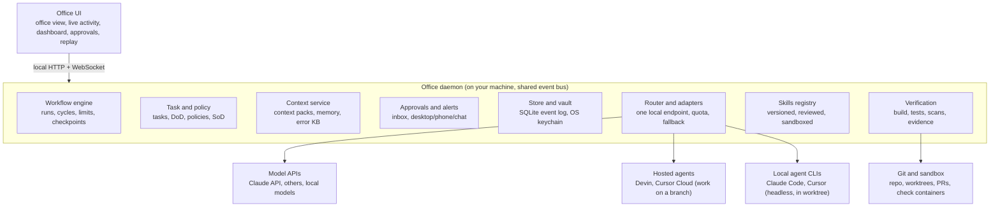
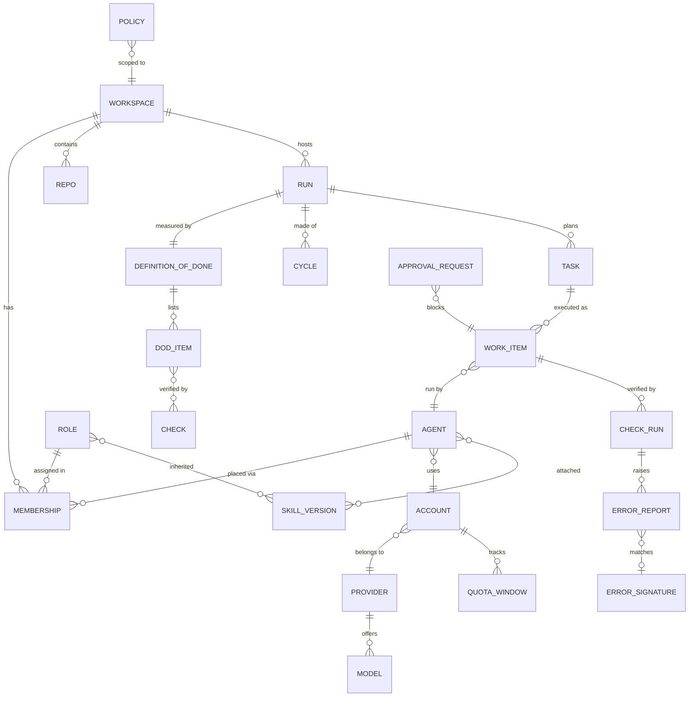
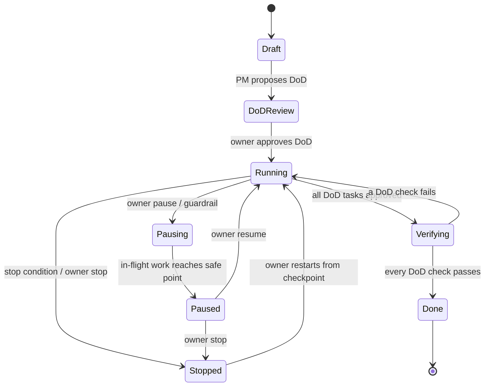
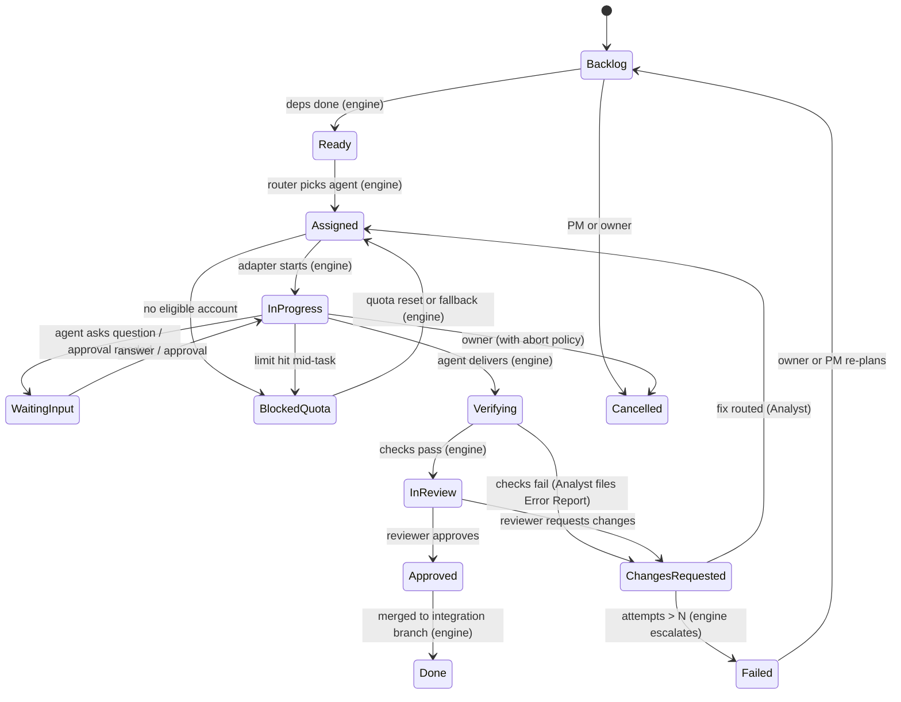
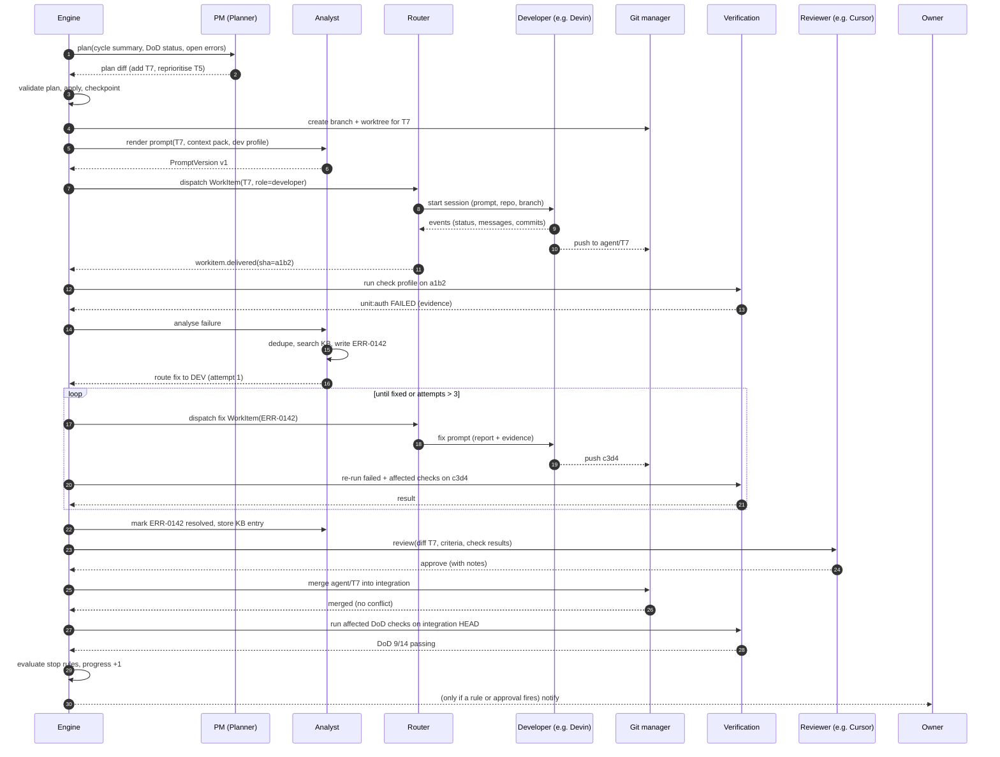
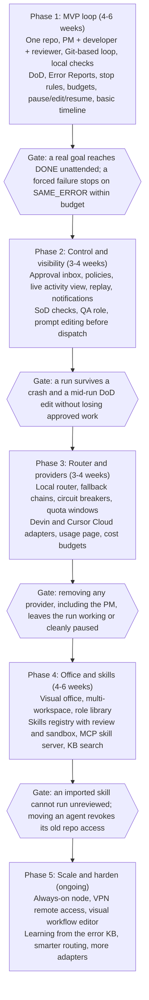
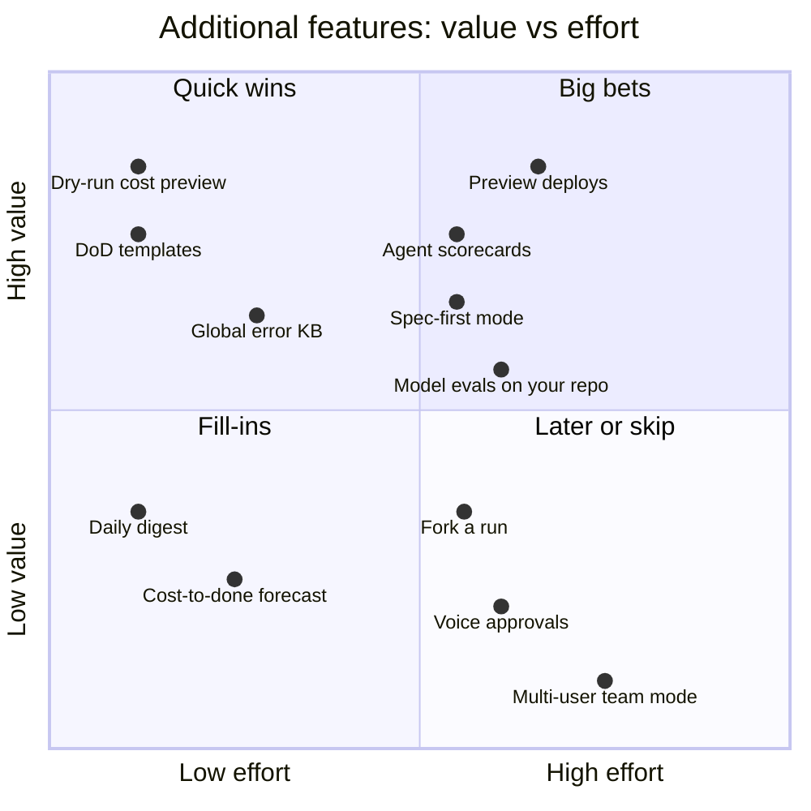

# AI Agent Office — Technical Specification

Oct 17, 2026 · Live version: https://claude.ai/code/artifact/6effa7ff-3a00-4044-92a8-3cc1f6d8d166

## 1. Executive summary

**Build a local-first orchestrator in which a deterministic workflow engine owns the build loop, AI agents make decisions and do work inside it, and Git plus a local verification runner are the shared ground truth.** The PM agent plans; it does not run the loop. That one choice makes every provider, including the PM and the Error Analyst, replaceable, and it keeps the loop from spinning forever.

**What the system is.** One desktop app ("the Office") with a background daemon. It holds workspaces, agents, tasks and runs in a local database, and exposes a visual office, a live activity view, a dashboard and an approval inbox. You give a run a goal. The PM agent turns it into an editable Definition of Done (DoD), which is a checklist of machine-checkable acceptance criteria. The engine then repeats cycles of plan → assign → build → verify → document → fix/approve until every DoD check passes, or a stop condition fires.

**Five design decisions carry the spec:**

1. **Engine owns the loop, agents own judgement.** The engine is a durable state machine: event-sourced, with checkpoints, idempotent steps and hard limits. Agents are called at defined decision points: plan, implement, review, analyse failure. If an agent's provider dies, the engine reassigns that decision point via a fallback chain, or pauses only the affected work.
2. **"Done" is measured, not judged.** Every DoD item maps to a check with a pass/fail result: build exits 0, named tests pass, coverage threshold met, zero open critical Error Reports, a review approved by a different agent, docs files present. Agents can propose DoD changes; only you can approve them once a run has started.
3. **Verification is code; analysis is AI.** I split your "Prompt & Error Analyst" into a deterministic **Verification Service** (runs build, typecheck, lint, tests and scans in a sandbox, and captures evidence) and an **Analyst agent** (writes prompts, interprets failures, writes Error Reports, routes fixes). Check results never depend on a model's opinion.
4. **Two kinds of provider.** *Model providers* (Claude API, OpenAI-compatible APIs, local models) are called through the built-in router, and the Office runs their tool loop. *Agent providers* (Devin, Cursor Cloud Agents, Claude Code headless, Cursor CLI) run their own loop and hand back a branch or PR. Both sit behind one adapter interface. Git is the handoff surface for every kind of agent.
5. **Local, private, pinned.** The router runs in-process on your machine. It talks only to provider endpoints you approve per workspace. Credentials live in the OS keychain. Adapters and skills are pinned, hash-verified, reviewed and sandboxed. Nothing uses consumer-subscription logins in unsupported ways or evades provider detection.

**Integration reality, in one line.** Claude via API key, Devin via its API, Cursor via its Cloud Agents API or CLI, and any OpenAI-compatible or local model can all be driven automatically. The Cursor IDE GUI and consumer chat apps are manual-tier only. Exact usage and reset data is official only where a provider returns it (for example, Anthropic's rate-limit headers). Everything else is shown as a labelled estimate. Section 8 marks each claim as confident or **verify**.

**MVP (Phase 1, about 4–6 weeks solo).** One workspace, one repo, and three agents: a PM on the Claude API, a developer on Devin or Claude Code headless, and a reviewer on the Cursor CLI or a second API model. It runs a real Git-based loop with local verification, Error Reports, DoD tracking, budget and stop limits, pause/edit/resume, and a basic live timeline. The visual drag-and-drop office, skills marketplace and mobile notifications come later.

**Biggest open risks:** a weak plan from the PM (mitigated by plan validation, DoD gating and re-plan triggers); cost overrun from hosted agents whose spend is reported late (mitigated by per-task caps and session timeouts); and provider terms changing (mitigated by the adapter layer and a manual tier).

## 2. Requirements analysis

**The requirements are coherent, but five of them conflict unless the spec picks a side. The resolutions below are binding for the rest of this document.**

### 2.1 Restated requirements

1. **Organize** AI agents like an office: workspaces, roles, skills, permissions, teams. Moving an agent changes its real access.
2. **Run autonomously**: one goal leads to repeated cycles until a measurable DoD is met or a guardrail stops the run.
3. **Analyse errors as a first-class job**: versioned prompts, automated checks, structured Error Reports, routed fixes, escalation, and a searchable error knowledge base.
4. **Stay interruptible**: pause, edit anything, resume, and survive crashes, without losing valid work.
5. **Stay provider-agnostic**: any provider (including the PM and the Analyst) can be swapped or removed. Capabilities are discovered per adapter.
6. **Route locally**: one internal endpoint with fallback, circuit breakers and quota-aware routing. No third-party router, and no ToS evasion.
7. **Show usage honestly**: usage, quota and reset times per account, each labelled by data source (official, header, or estimate).
8. **Be observable**: live actions, provider-exposed reasoning only (never fabricated), and full replay.
9. **Treat skills as packages**: versioned, portable, reviewed and sandboxed.
10. **Keep the human in control**: policy-based approvals, notifications, budgets, and an audit log.

### 2.2 Conflicts and how this spec resolves them

| Conflict | Resolution |
| --- | --- |
| "PM decides what happens next" vs "the PM must be removable" | The engine owns cycle control flow. The PM is a pluggable **Planner** called at fixed decision points. With no PM available, the engine keeps executing the current plan and pauses only when a new planning decision is needed. |
| "Never stop until done" vs "never spin or overspend" | Autonomy is bounded. Every run has hard budgets (money, cycles, wall-clock time) and progress-based stop rules (section 5.5). Stop rules always beat the loop. |
| "Error Analyst runs checks" vs "done must not be an agent's opinion" | Checks run in the deterministic Verification Service. The Analyst only interprets results. A check's pass/fail is never set by an LLM. |
| Real-time visibility of everything vs hosted agents that expose little | The UI shows a per-agent **observability level** (section 8.6). For hosted agents you get session status, messages, commits and CI results, not keystroke-level activity. |
| "No code leaves my machine" vs using Devin or Cursor Cloud | Hosted agents run on the vendor's servers and must clone your repo. That is allowed only if you add the vendor to the workspace's approved-provider list. The rule becomes "no third party *other than approved providers*", which matches your success criterion. |

### 2.3 Ambiguities and the assumptions I made

| Ambiguity | Assumption (change it in section 13 if wrong) |
| --- | --- |
| How you pay for each tool | Claude via **API key** (Console), Devin via a plan with API access, Cursor via a plan with an API key for the CLI and Cloud Agents. Consumer chat apps are manual tier only. |
| What "app" means | Software projects in Git repos with a scriptable build and test command. Non-code deliverables (designs, content) are out of scope for v1. |
| Single user? | Yes. One owner, one machine, plus optional remote access. No multi-tenant features. |
| Where tests come from | Existing tests, plus acceptance tests written by QA from the DoD before or alongside implementation. |
| Your OS | Windows is primary (your project folder is on Windows), with macOS and Linux supported. Sandboxed verification runs in containers (Docker Desktop or Podman, using WSL2 on Windows). |
| Deploy targets | Deployment is out of scope for v1 beyond an optional "deploy to preview" step that always needs approval. |
| Agent identity for separation of duties | Separation of duties applies **per agent** by default. An optional stricter mode applies it per provider or model family (section 6.4). |

### 2.4 Proposed changes to your concept model

Your definitions are kept, with four additions:

- **Provider kind.** `model` (we send tokens and run the tool loop) vs `agent` (the vendor runs the loop and returns a branch or PR) vs `manual` (a human relays the work). This drives the adapter interface, observability and routing.
- **Check.** A named, deterministic verification (command + parser + pass rule). DoD items reference checks. This makes "done" computable.
- **Policy.** A first-class entity (allow / require-approval / forbid per action) attached to workspace, role or agent, resolved most-restrictive-wins.
- **Membership.** An agent's placement in a workspace, with its own role, permissions and context scope. This is what drag-and-drop creates and removes.

## 3. System architecture

**The Office is one local daemon with nine components on a shared event bus, plus a UI client. Everything that reaches a provider goes through the Router or an adapter.**



*Traffic leaves your machine only to providers you approve per workspace.*

The engine never calls a provider directly: it emits a work item, and the Router picks an agent, account and model under policy and quota. Verification runs in local containers, not inside any agent.

| Component | Responsibility | Owns (data) |
| --- | --- | --- |
| **Workflow engine** | Runs runs and cycles as a durable state machine. Schedules phases, enforces budgets and stop rules, writes checkpoints, applies user edits at safe points. Never calls an LLM directly. | Run, Cycle, Checkpoint, WorkItem |
| **Task and policy service** | Task CRUD and state machine, dependencies, DoD and checks, policy resolution, separation-of-duties checks. | Task, DoDItem, Check, Policy |
| **Context service** | Builds the minimal context pack per work item (files, summaries, prior errors, skills). Holds project memory, the repo index and the error knowledge base. | ContextPack, MemoryEntry, ErrorKB |
| **Approvals and alerts** | Approval requests, decisions with reasons, and notification fan-out (desktop, ntfy/webhook, chat bot). | ApprovalRequest, Notification |
| **Store and vault** | SQLite database plus an append-only event log (the source of truth for replay); blob store for logs and diffs; OS keychain for secrets. | Event, Blob, SecretRef |
| **Router and adapters** | One local endpoint for model calls; adapter host for agent providers; capability discovery; quota tracking; fallback chains; circuit breakers; cost metering. | Provider, Account, Model, QuotaWindow, UsageRecord |
| **Skills registry** | Imports, versions, reviews and delivers skills. Runs skill scripts in a sandbox. | Skill, SkillVersion, SkillReview |
| **Verification service** | Runs checks in disposable containers against a task's worktree; captures logs, test reports and coverage; computes pass/fail; detects flaky tests. | CheckRun, Evidence |
| **Git manager** (inside Git and sandbox) | Creates a branch and worktree per task, watches remote branches and PRs from hosted agents, merges to the integration branch, detects conflicts. | Worktree, Branch, MergeRecord |
| **Office UI** | Desktop app (or browser on localhost). Pure client of the daemon API; holds no state of its own. | — |

**Process model.** One daemon process holds the engine, services and router. Adapters for CLIs spawn child processes in the task's worktree. Verification and skill scripts run in containers. The UI connects over `localhost` (or via an optional authenticated tunnel for remote access, section 10).

**Data flow for one work item:** engine creates WorkItem → Context service builds a context pack → Analyst renders the prompt → Router selects agent and account → adapter executes → events stream to the event log and UI → result (diff, branch or PR) lands in Git → Verification runs checks → engine advances the task state.

## 4. Domain and data models

**About 25 entities, stored in SQLite and fed by an append-only event log. Every state change is an event first and a row update second, so any run can be replayed.** Schemas below use TypeScript-style notation; `?` means optional; IDs are ULIDs (sortable by time).

### 4.1 Entities and relationships



### 4.2 Core entities (key fields)

```ts
Provider   { id, name, kind: 'model'|'agent'|'manual', adapterId, adapterVersion,
             adapterHash, tier: 1|2|3, enabled, capabilities: Capabilities }
Account    { id, providerId, label, secretRef, plan?, billing: 'payg'|'subscription'|'credits',
             monthlyBudgetUsd?, dataRetention: RetentionSettings, enabled }
Model      { id, providerId, name, contextTokens, maxOutputTokens, priceIn, priceOut,
             priceCacheRead?, strengthTier: 'fast'|'standard'|'strong', supports: ModelSupports }
Role       { id, name, version, responsibilities[], allowedActions[], inputs[], outputs[],
             defaultInstructions, handoffRules[], defaultSkills[], defaultPolicyId }
Agent      { id, name, avatar, accountId, modelId, settings: ModelSettings,
             instructions, skillVersionIds[], caps: { perTaskUsd, perDayUsd, maxTokensPerCall },
             status: AgentStatus, observability: 'full'|'actions'|'status-only'|'manual' }
Workspace  { id, name, purpose, repoIds[], allowedProviderIds[], policyId,
             memoryScope: 'isolated'|'shared-with:[ids]', settings }
Membership { id, agentId, workspaceId, roleId, team?, permissionsOverride?, contextScope,
             activeSince, maxConcurrentTasks }
Repo       { id, workspaceId, remoteUrl, defaultBranch, integrationBranch, buildCmd, testCmd,
             checkProfileId }
Policy     { id, scope: {workspaceId?|roleId?|agentId?},
             rules: { action: ActionType, effect: 'allow'|'approve'|'forbid', condition? }[] }
Run        { id, workspaceId, goal, status: RunStatus, dodId, budget: Budget,
             limits: StopLimits, currentCycle, planVersion, startedAt, checkpointId }
Cycle      { id, runId, n, phase, startedAt, endedAt?, progressScore, spendUsd, summary }
Task       { id, runId, parentId?, title, description, type: TaskType, status: TaskStatus,
             priority: 0..3, deadline?, dependsOn[], acceptanceCriteria[], deliverables[],
             ownerAgentId?, reviewerAgentId?, plannedBy, branch?, worktree?, difficulty: 1..5,
             attempts, budgetUsd, spentUsd, dodItemIds[] }
WorkItem   { id, taskId, kind: 'plan'|'implement'|'review'|'test'|'analyse'|'fix'|'doc',
             agentId, accountId, modelId, promptVersionId, idempotencyKey, status,
             startedAt, heartbeatAt, result?: { diffRef?, branch?, prUrl?, summary, usage } }
PromptVersion { id, workItemId?, templateId, version, renderedText, contextPackHash,
             editedByUser: bool, createdAt }
Check      { id, name, kind: 'build'|'typecheck'|'lint'|'unit'|'integration'|'e2e'|
             'coverage'|'security'|'custom'|'review'|'doc', command, parser,
             passRule, timeoutSec, affectedPaths? }
CheckRun   { id, checkId, workItemId, commitSha, status: 'pass'|'fail'|'error'|'flaky',
             durationMs, evidenceRefs[], summary, failures[] }
ApprovalRequest { id, workItemId, action, payload, requestedBy, status, decidedAt?,
             reason?, expiresAt? }
Event      { seq, runId, ts, actor, type, entityId, payload, prevHash, hash }  // append-only, hash-chained
```

### 4.3 Run state machine



`Stopped` always records a `stopReason` (one of the codes in section 5.5). `Done` is reachable only from `Verifying`, and only the engine can move a run there.

### 4.4 Task state machine



| Transition | Who may trigger |
| --- | --- |
| Create, Cancel (from Backlog) | PM, owner |
| Backlog → Ready → Assigned → InProgress | Engine only (deterministic) |
| → WaitingInput | Executing agent, or the policy engine |
| → Verifying, → InReview, → Done | Engine only, based on CheckRun results and merge success |
| InReview → Approved / ChangesRequested | Assigned reviewer (must pass the separation-of-duties check), or owner |
| ChangesRequested → Assigned | Analyst (picks the fixer); the engine validates eligibility |
| → Failed | Engine, when attempt or budget limits are exceeded |
| Any state → Cancelled, any field edit | Owner, always |

Agent status (shown on the dashboard) is derived, not stored: `working | thinking | waiting | reviewing | blocked | idle | done | offline`.

### 4.5 Error Report schema

```ts
ErrorReport {
  id: 'ERR-2026-0142',            // human-readable, unique per workspace
  runId, cycleN, taskId, workItemId,
  severity: 'critical'|'high'|'medium'|'low',  // critical = blocks build or DoD
  status: 'open'|'assigned'|'fixing'|'verifying'|'resolved'|'reopened'|'escalated'|'wontfix',
  failingCheck: { checkId, checkRunId, commitSha, command, exitCode },
  title: string,                    // one line
  evidence: {
    logExcerpt: string,             // trimmed to the relevant lines, <= 200 lines
    stackTrace?: string,
    fullLogRef: BlobRef,            // untrusted data, never fed raw into prompts
    failingTests?: { name, file, message }[],
    screenshots?: BlobRef[]
  },
  reproduction: { steps: string[], command: string, env: { image, nodeVersion?, ... } },
  affectedFiles: { path, lines?: [from, to] }[],
  suspectedCause: { summary: string, confidence: 'low'|'medium'|'high', reasoningSource: 'analyst' },
  signature: string,                // normalized hash (error type + top frames + check), for dedupe
  relatedErrors: { id, similarity, resolution? }[],   // from the error knowledge base
  suggestedFix: { approach: string, difficulty: 1..5, suggestedRole, avoid?: string[] },
  assignment: { fixerAgentId, assignedAt, attempt: number, maxAttempts: number },
  history: { attempt, agentId, commitSha, checkRunId, outcome: 'fixed'|'still-failing'|'new-failure' }[],
  escalation?: { to: 'other-agent'|'stronger-model'|'owner', reason, at },
  resolution?: { commitSha, summary, verifiedByCheckRunId, resolvedAt, kbEntryId }
}
```

Dedupe rule: a new failure whose `signature` matches an open report adds evidence to that report instead of opening a new one.

### 4.6 Skill schema

```ts
Skill        { id, name /* kebab-case */, description, ownerOrigin: 'local'|'imported',
               sourceUrl?, latestVersionId, enabled }
SkillVersion { id, skillId, semver, contentHash /* sha256 of the folder tarball */,
               manifest: SkillManifest, reviewStatus: 'unreviewed'|'approved'|'rejected',
               reviewedAt?, reviewNotes?, createdAt }
SkillManifest {
  name, description,               // description drives when agents pick the skill
  triggers?: string[],             // task types or keywords that suggest it
  delivery: ('prompt'|'tool'|'mcp'|'repo-file')[],
  scripts?: { path, runtime: 'python'|'node'|'bash', network: 'none'|'allowlist', allow?: string[],
              fsWrite: 'none'|'worktree', timeoutSec }[],
  requires?: { tools?: string[], secrets?: string[] },   // secrets need owner approval
  compat: { providers?: string[], minContextTokens? }
}
SkillAttachment { skillVersionId, target: {roleId}|{agentId}, pinned: bool /* else follow latest approved */ }
```

### 4.7 Account and quota schema

```ts
QuotaWindow {
  id, accountId, modelId?,          // null = account-wide
  metric: 'requests'|'input_tokens'|'output_tokens'|'tokens'|'usd'|'acu'|'sessions'|'messages',
  kind: 'rolling'|'fixed'|'token-bucket',
  period: 'minute'|'5h'|'day'|'week'|'month'|'custom',
  limit?: number, used?: number, remaining?: number,
  resetsAt?: timestamp,             // absolute time; the UI renders a countdown + local time
  source: 'official-api'|'response-header'|'estimate'|'manual-entry',
  confidence: 'exact'|'approximate'|'unknown',
  observedAt: timestamp
}
UsageRecord { id, accountId, modelId?, workItemId, ts, inputTokens?, outputTokens?,
              cacheReadTokens?, requests: 1, costUsd, costSource: 'provider'|'computed'|'estimate' }
CircuitState { accountId, modelId?, state: 'closed'|'open'|'half-open', openedAt?, reason, nextProbeAt }
```

The `source` and `confidence` fields are mandatory, and the UI always shows them. An estimate is computed from `UsageRecord` totals against a limit you enter by hand (for example, "Devin: 250 ACUs per month").

## 5. The continuous build loop

**A run is a sequence of cycles. Each cycle moves every ready task one step forward. The run ends only when all DoD checks pass on the integration branch, or when a stop rule fires.** The engine is event-driven, not timer-driven: a cycle boundary is a planning checkpoint, while individual tasks flow through their own state machine continuously and in parallel.

### 5.1 Phases of a cycle

| # | Phase | Owner | What happens | Exit trigger |
| --- | --- | --- | --- | --- |
| 0 | **Bootstrap** (run start only) | PM, then owner | PM reads the goal and the repo index and drafts the DoD and the initial task graph. The engine validates the plan (section 5.3). The owner approves the DoD. | Owner approves DoD |
| 1 | **Plan** | PM (Planner) | Reviews the last cycle summary, open Error Reports and DoD status. Adds, splits, reprioritises or cancels tasks. Output is a *plan diff*, not a new plan. | Plan diff validated and applied |
| 2 | **Assign** | Engine + Router | Picks every Ready task, checks separation of duties, picks agent/account/model by routing rules and quota, creates branch + worktree. | All Ready tasks assigned or BlockedQuota |
| 3 | **Prompt** | Analyst | Renders a versioned prompt per WorkItem from task, context pack, skills and the receiving agent's provider profile. | PromptVersion stored |
| 4 | **Build** | Developer agents (parallel) | Agents implement on their own branch. The adapter streams events. | Agent delivers (commit, PR or result) or times out |
| 5 | **Verify** | Verification service | Runs the check profile on the delivered commit in a container: build, typecheck, lint, affected tests, then security scan. | All CheckRuns finished |
| 6 | **Document** | Analyst | For each failing CheckRun: dedupe by signature, query the knowledge base, write or update the Error Report. Writes a cycle summary. | Reports filed |
| 7 | **Fix / Review** | Fixer agents; Reviewer; QA | Failures route to fixers (sub-loop, section 5.6). Passing work goes to review; QA runs acceptance and E2E checks. Approved tasks are merged to the integration branch. | Tasks Approved, Failed or ChangesRequested |
| 8 | **Evaluate** | Engine | Re-runs the DoD checks that the merged changes affect on the integration branch. Computes the progress score. Evaluates stop rules. | Next cycle, Verifying, Paused or Stopped |

**Parallelism.** Phases 3–7 run per task, concurrently. Independent tasks (no `dependsOn` edge and no overlapping `affectedPaths` lock) run at the same time, up to `run.limits.maxParallel` (default 3) and each agent's `maxConcurrentTasks` (default 1). Phase 1 runs once per cycle. It starts when the last in-flight task of the previous cycle reaches a terminal or waiting state, or after `cycleMaxMinutes` (default 60), whichever comes first. Slow tasks keep running across that boundary.

**Why cycles at all?** They give the PM a bounded, summarised view to re-plan from, a natural safe point for your edits, and a unit for measuring progress and cost.

### 5.2 Definition of Done

A run's DoD is a list of items. Each item references one or more checks and passes only when all of them pass on the **integration branch HEAD**.

```yaml
dod:
  version: 3                     # every edit bumps the version; history kept
  items:
    - id: F1
      text: "User can sign up with email and password"
      kind: feature
      checks: [e2e:signup.spec.ts, unit:auth/*]
    - id: Q1
      text: "Build succeeds"
      kind: quality
      checks: [build]
    - id: Q2
      text: "All tests pass, coverage >= 70% on src/"
      checks: [unit:all, integration:all, coverage>=70:src/]
    - id: Q3
      text: "No open critical or high Error Reports"
      checks: [errors:open(severity>=high)==0]
    - id: Q4
      text: "No high-severity findings from dependency and secret scans"
      checks: [security:deps, security:secrets]
    - id: R1
      text: "Every merged task approved by an agent other than its author"
      checks: [review:all-merged-approved]
    - id: D1
      text: "README has setup + run instructions; API documented"
      checks: [doc:file-exists(README.md), doc:sections(README.md,[Setup,Run]), doc:openapi-valid]
```

Rules:

- **Goal → DoD.** The PM proposes items in four kinds: feature, quality, review, docs. Each feature item must name at least one executable check. If no test exists yet, the check is created as a QA task to write it, so the check fails (red) until implemented.
- **Checks are machine-evaluated.** Only `review:` checks reflect an agent's judgement, and they require an approval record from an eligible reviewer (section 6.4). A DoD item with no executable check is rejected by the validator.
- **Owner review before the run.** The run stays in `DoDReview` until you approve. You can edit, add, delete or mark items as `optional`.
- **Edits during the run.** You can edit at any time; edits take effect at the next safe point. The PM may *propose* DoD changes (for example, "F3 is infeasible as stated"); these land in your approval inbox and never apply automatically.
- **Anti-gaming.** Agents cannot edit check definitions, test files tagged `acceptance`, or CI config without approval. The Verification service runs checks from the integration branch's check profile, not from the task branch. A developer cannot make a test pass by deleting it: deleted or skipped acceptance tests count as failures.
- **Progress.** `progress = passing DoD items / required DoD items`, shown per cycle.

### 5.3 Plan validation (protection against a bad PM)

Before any plan diff applies, the engine checks it deterministically:

- Every task has acceptance criteria and maps to at least one DoD item (or is tagged `infra`/`refactor` with a reason).
- The dependency graph has no cycles; no task is larger than `difficulty 5` (larger ones must be split).
- The plan diff does not cancel more than 30% of completed or approved work. Doing so requires owner approval.
- Estimated cost (sum of task budgets) fits the remaining run budget.
- A second model (configurable; by default a cheap model on a different provider) runs a short **plan critique** at bootstrap and when a re-plan cancels or rewrites more than 3 tasks. Critique findings are attached to the plan; severe findings send it to your inbox.

If validation fails twice in a row, the engine escalates the planning decision to the next Planner in the fallback chain, then to you.

### 5.4 Triggers between phases

Every transition is an event in the log. The engine reacts to: `workitem.delivered`, `checkrun.completed`, `review.decided`, `approval.decided`, `quota.reset`, `circuit.closed`, `owner.edit`, `owner.command`, `timer.cycleMax`, `heartbeat.missed`. Nothing waits on a human unless a policy says so; while one task waits for you, other tasks continue.

### 5.5 Stop conditions and guardrails

| Code | Condition | Default | Action |
| --- | --- | --- | --- |
| `DONE` | All required DoD items pass on integration HEAD | — | Run → Done, notify |
| `BUDGET_RUN` | Run spend reaches budget | $50 | Stop new work; finish in-flight up to 10% overrun; then Stop |
| `BUDGET_WARN` | Run spend reaches 80% of budget | 80% | Notify; continue |
| `BUDGET_TASK` | A task exceeds its budget | 3× estimate, max $10 | Task → Failed; Analyst escalates |
| `QUOTA_ALL` | No eligible account for any Ready task | — | Pause run until earliest reset; notify with reset time |
| `SAME_ERROR` | Same error signature fails after N fix attempts | N = 3 | Escalate (5.6); after escalation also fails → owner, task Blocked |
| `NO_PROGRESS` | Progress score unchanged for N cycles | N = 3 | Pause; PM writes a stuck report; notify |
| `REGRESSION` | Progress score drops 2 cycles in a row | — | Pause; notify with the diff of DoD results |
| `DISAGREE` | Reviewer rejects the same task K times, or two agents' decisions conflict | K = 3 | Owner arbitration; task waits, others continue |
| `FORBIDDEN` | Agent requests a forbidden action | — | Action blocked; work item aborted; logged; owner notified. Run continues unless it repeats 3× |
| `MAX_CYCLES` | Cycle count reaches limit | 30 | Stop |
| `MAX_WALLCLOCK` | Run age exceeds limit | 48 h | Stop |
| `STUCK_AGENT` | No heartbeat or event from a work item for T | 10 min (API), 45 min (hosted agent) | Cancel the work item; retry once on another agent; then Failed |
| `OWNER` | You pause or stop | — | As requested |

Two invariants: **(1)** no identical work item (same task, same prompt hash, same commit) runs more than twice; **(2)** the engine refuses to dispatch a work item whose estimated cost exceeds the remaining budget. Together these make silent endless spending impossible.

### 5.6 Error-fix sub-loop and escalation

```
attempt 1: fixer = original developer (has context), same model
attempt 2: same fixer + KB matches + Analyst's narrower prompt
attempt 3: different agent, or same agent on a stronger model
then:      owner (task -> Blocked with Error Report linked); run continues on other tasks
```

The escalation ladder is configurable per role. A fix is accepted only when the *same* failing checks pass and no new check fails (no regressions in affected tests).

### 5.7 Sequence: one full cycle with an error-fix sub-loop



### 5.8 Interrupt, modify, resume

**Durable state.** Every engine decision is written as an event *before* it acts (write-ahead). A checkpoint (a snapshot of run, task and work-item tables plus the event sequence number) is taken at every cycle boundary and every 5 minutes. On restart, the engine loads the latest checkpoint, replays later events, and **reconciles** each in-flight work item with its provider: it polls the hosted session status, checks whether the CLI child process is alive, and checks the branch head SHA. Work items have idempotency keys, so a replayed dispatch never creates a duplicate session.

**Pause semantics.**

- *Soft pause* (default): no new work items dispatch; in-flight items continue to their next safe point.
- *Hard pause*: in-flight items are suspended where the provider allows it (for example, sleeping a Devin session or killing a CLI after committing WIP to its branch). Otherwise they are aborted, and their branch is kept.

**Safe points** are where changes take effect: (a) between work items, (b) at a cycle boundary, (c) at a commit boundary inside a build, for agents that commit incrementally. Edits to tasks, priorities, DoD, prompts, roles, skills and assignments are queued as `owner.edit` events and applied at the next safe point that affects them. Instructions to a specific agent are delivered immediately if the adapter supports mid-session messages (Devin and Claude Code sessions do; verify for Cursor). Otherwise they are delivered at that agent's next work item.

**Changing a task with work in progress.** You choose per edit; the default is in brackets:

| Option | Effect |
| --- | --- |
| **Finish then apply** \[default for priority, deadline, wording changes\] | Current work item completes; the change applies to the next one. |
| **Abort and roll back** \[default for cancel and for scope changes\] | Work item cancelled; branch kept as `abandoned/T7-<ts>` for reference; worktree reset. |
| **Hand off** \[default for agent reassignment\] | Current branch plus an auto-generated handoff note (done, remaining, open questions) goes to the new agent. |

**Re-planning after your edits.** At the next safe point the PM receives a structured *change set* (your edits as a diff) plus the list of tasks in `Approved` or `Done`. Those tasks are frozen: the plan validator rejects any re-plan that modifies them unless your edit explicitly invalidated them (for example, you changed the DoD item they satisfy). Invalidated work is re-verified against the new checks first and re-opened only if it now fails.

### 5.9 Efficiency strategies

| Strategy | Mechanism |
| --- | --- |
| Minimal context | Context packs: task text, acceptance criteria, relevant file slices (from a symbol index plus embeddings), interface summaries of neighbouring modules, and only the Error Reports for this task. A hard token budget per role (for example, a developer gets 40k, a reviewer gets the diff plus 10k). |
| Caching | Stable prefix ordering (role instructions → skills → repo summary → task) to maximise provider prompt caching. Local cache of repo summaries keyed by tree hash. |
| Summarisation | Cycle summaries (≤ 500 tokens) replace raw history for the PM. Long logs are trimmed to failing sections before reaching any model. |
| Incremental verification | A test-impact map (from coverage data or import graph) selects affected tests per diff. The full suite runs on integration HEAD at cycle end and always before `Done`. |
| Error dedupe | Signature hashing; recurring signatures pull the KB fix into the prompt; identical failures across tasks are fixed once. |
| Difficulty-based routing | The PM scores difficulty 1–5. 1–2 go to fast/cheap models, 3 to standard, 4–5 to strong models or hosted agents. Escalation moves up a tier only on failure. |
| Parallelism | Independent tasks run concurrently, bounded by budget and quota. |
| Review economy | Diffs under 30 changed lines with all checks green and no sensitive paths get a lightweight review (cheap model); sensitive paths (auth, payments, migrations, CI) always get a full review. |
| Early abort | Hosted sessions are cancelled when the task is cancelled, the branch is superseded, or the cost cap is hit. |

## 6. Agent and role design

**Roles are versioned templates. An agent gets a role only through a Membership in a workspace, and its effective permissions are the most restrictive combination of workspace, role and agent policy.** Your example setup has two separation-of-duties gaps, fixed in 6.4.

### 6.1 Role templates

| Role | Responsibilities | Allowed actions (default) | Inputs → Outputs | Hands off to |
| --- | --- | --- | --- | --- |
| **Project Manager** (Planner) | Goal → DoD draft; task graph; difficulty and budget estimates; re-plans per cycle; answers agents' scope questions | Read repo and index, read all run state, create/edit/cancel tasks (not frozen ones), propose DoD changes. **No** code writes, merges or approvals of its own plan's output | Goal, cycle summary, DoD status, error digest → plan diff, DoD proposal, stuck report | Engine (plan diff), owner (DoD, disputes) |
| **Software Developer** | Implement tasks and fixes on its own branch; write unit tests for its code | Write in its worktree, run local commands in sandbox, push to `agent/<task>` branches, open PRs to the integration branch. **Approval:** add dependencies. **Forbidden:** push to main or integration, edit `acceptance` tests or CI | Prompt + context pack → commits, PR, handoff note | Verification (automatic), Reviewer |
| **Code Reviewer** | Review diffs for correctness, design, maintainability; enforce conventions; guard sensitive paths | Read diff and repo, comment, approve or request changes, propose small suggested patches as comments. **No** pushes | Diff, criteria, check results → review decision + findings | Engine; fixer via Analyst |
| **QA Tester** | Turn DoD feature items into acceptance and E2E tests *before or alongside* implementation; exploratory testing; flaky-test triage | Write under `tests/acceptance/**` on `qa/<item>` branches; run test suites. **Forbidden:** edit `src/**` | DoD items, app build → acceptance tests, test reports, bug reports | Verification, Analyst |
| **Prompt and Error Analyst** | Prompt rendering; failure analysis; Error Reports; fix routing; escalation; KB curation; cycle summaries | Read everything in the run, write Error Reports and prompt versions, assign fixes (validated by engine), trigger check re-runs. **No** code writes, **no** approvals | Tasks, CheckRuns, evidence, KB → PromptVersions, Error Reports, routing decisions | Fixer agents, engine, owner (escalations) |
| **Researcher** | Answer focused questions (library choice, API behaviour) with sources | Web search and fetch (if allowed by workspace policy), read repo. No writes | Question → cited brief (≤ 1 page) | Requesting agent, PM |
| **Architect** | Design for difficulty ≥ 4 tasks: module boundaries, interfaces, data models, ADRs | Write `docs/adr/**`, interface stubs on its branch | Task + repo → ADR, interface stubs, task-split proposal | PM, developers |
| **Security Reviewer** | Review diffs touching sensitive paths; triage scanner findings; threat-model new endpoints | Read, comment, block merge on high findings | Diff + scan output → security review | Engine, Analyst |
| **Documentation Writer** | README, API docs, changelog, user docs per DoD docs items | Write `docs/**`, `README.md`, `CHANGELOG.md` | Merged diffs, ADRs → docs PRs | Reviewer |

### 6.2 The Prompt and Error Analyst in detail

The Analyst is an agent (any provider), but its output is constrained by schemas and validated by the engine.

**Prompt generation.**

```
renderPrompt(workItem):
  profile  = providerProfile(agent)        # style per provider: hosted agents get a
                                           # self-contained brief + repo/branch facts;
                                           # API models get a tool-oriented prompt
  skills   = selectSkills(agent, task)     # manifest triggers + description match
  context  = contextService.pack(task, role.tokenBudget)
  template = role.promptTemplate@version
  prompt   = template.render(task, criteria, context, skills, errorReports, constraints,
                             outputContract)   # e.g. "push to branch agent/T7; write
                                               # HANDOFF.md; do not touch tests/acceptance"
  store PromptVersion(prompt, contextPackHash, templateVersion)
```

Templates are versioned files (`prompts/<role>/<provider-kind>.md`). You can edit a template (affecting all future prompts) or a single rendered PromptVersion before dispatch (in a paused run, or with "hold for review" enabled on the task).

**Verification.** The Analyst does not run checks itself. It chooses *which* check profile applies (fast for in-progress fixes, full for merges) and calls the Verification service, which returns structured CheckRuns.

**Error documentation.** For each failing CheckRun: compute the signature → if an open report matches, append evidence; otherwise query the KB for similar signatures and text, draft the report (schema in 4.5), and assign severity by rule (build broken or DoD-blocking = critical; failing test in changed code = high; lint = low). The LLM fills only `title`, `suspectedCause`, `reproduction.steps`, `suggestedFix`; the engine fills facts (`failingCheck`, `evidence`, `affectedFiles` from the diff and stack trace).

**Routing.** Score candidates: `eligible (policy + SoD + quota) × (role fit + same-task context bonus + past success on similar signatures − cost)`. Attempts follow the escalation ladder in 5.6.

**Knowledge base.** On resolution, store `{signature, normalized error text, root cause, fix summary, diff excerpt, files, tags}` with an embedding. KB search combines exact signature match with semantic similarity. KB entries are per workspace by default; you can promote entries to global.

**When the Analyst is unavailable.** The engine falls back to a template-only prompt renderer and rule-only reports (facts without the LLM fields), routed back to the original developer. The loop slows down but keeps working.

### 6.3 Permission model

Actions are a closed enum, so policies are checkable:

`repo.read, repo.write.worktree, git.push.agent_branch, git.push.integration, git.merge.main, git.force_push, pr.open, pr.merge, deps.add, deps.remove, file.delete, file.write.protected (CI, acceptance tests, check profiles), shell.run.sandbox, shell.run.host, network.egress(domain), secret.read(name), skill.run_script, deploy.preview, deploy.prod, spend.over(threshold), external.call(service), task.create, task.cancel, dod.propose, review.approve`

Resolution: for an action, collect matching rules from workspace → role → agent policies; **forbid beats approve beats allow**; an agent-level rule can only tighten, never loosen, a workspace rule. Default policy (on by default):

| Effect | Actions |
| --- | --- |
| Allow | `repo.read`, worktree writes, push to `agent/*`, open PRs, sandboxed shell, task create (PM) |
| Require approval | `deps.add`, `file.delete` outside the task's own new files, `skill.run_script` for unreviewed skills, `secret.read`, `network.egress` to non-allowlisted domains, `spend.over($5 per work item)`, `deploy.preview`, `pr.merge` into `main` |
| Forbidden | `git.force_push`, `git.merge.main` without approval, `shell.run.host`, `deploy.prod`, `file.write.protected` (except QA on acceptance tests) |

**Enforcement points.** For API-model agents, the Office runs the tool loop, so every tool call is checked before it executes (hard enforcement). For CLI agents (Claude Code, Cursor CLI), the Office sets each tool's own permission configuration (allowed tools, permission modes, hooks where supported), runs it in a container whose only writable mount is the worktree, and enforces Git rules on the remote with branch protection. For hosted agents (Devin, Cursor Cloud), enforcement is **at the Git boundary only**: they can do anything inside their own VM, so the Office gives them a repo-scoped token, protects `main` and `integration` with branch protection, and treats their output as an untrusted PR. The UI shows each agent's enforcement level.

### 6.4 Separation of duties

Rules (on by default; each can be switched off per workspace):

1. **Author ≠ reviewer.** The approving reviewer of a task must not be its author or any fixer on it.
2. **Author ≠ sole tester.** Each DoD feature item needs at least one acceptance test written by an agent other than the implementer.
3. **Planner ≠ sole judge.** The PM cannot approve tasks, and cannot be the only reviewer of a DoD it drafted (the owner approves DoD).
4. **Fix verifier is deterministic.** Fix acceptance uses checks, never the fixer's claim.
5. **Optional strict mode:** rules 1–2 apply at the provider or model-family level (different models catch different mistakes).

Conflicts in your example setup:

| Conflict | Why it's a problem | Fix |
| --- | --- | --- |
| QA unassigned; the natural defaults are Devin (writes code) or Claude (planned it) | Devin testing its own code breaks rule 2. The PM testing its own plan's output weakens rule 3. | Assign QA to a **separate agent on a different provider or model**, e.g. a GPT- or Gemini-class API model, or a second Claude agent on a different model in strict-mode-off. Tests come from DoD items, not from the implementation. |
| Cursor is reviewer *and* a natural fixer for small review comments | If Cursor applies its own suggested fix, then approves it, it reviews its own work. | The router excludes the task's reviewer from fixer candidates. If Cursor must fix, a second reviewer (cheap model) approves. |
| Error Analyst writes prompts *and* judges fixes | Mild: it could write a prompt that leads to the outcome it later judges. | Already handled: fix acceptance is check-based (rule 4). |
| Claude as PM *and* Analyst (if you assign both to Claude) | The same model then plans, prompts and interprets failures, so a planning blind spot repeats everywhere. | Use a different model for the Analyst, or at least a separate agent with its own instructions; enable plan critique (5.3) on another provider. |

On assignment, the engine checks these rules. A violation blocks the assignment and shows the reason in the office view.

### 6.5 Handoff protocol

Every handoff is a typed message stored as an event:

```ts
Handoff { from: agentId, to: agentId|role, taskId, kind: 'deliver'|'review'|'fix'|'question'|'reassign',
          summary /* <= 300 words */, artifacts: { branch, sha, prUrl?, files[] },
          openQuestions[], doneCriteria[], evidenceRefs[] }
```

Agents that work in Git also write the same content to `HANDOFF.md` on their branch (stripped before merge), because hosted agents can read the repo but not the Office's database.

### 6.6 Moving an agent (drag and drop)

Dropping agent A from workspace X onto workspace Y (or onto a different role) creates or edits a **Membership**:

| What | Effect |
| --- | --- |
| Repo access | Worktree mounts and repo tokens for X are revoked at the agent's next safe point; tokens for Y's repos are issued. Hosted agents: the repo list in their session config changes for new sessions only. |
| Permissions | Recomputed from Y's policy + new role + agent overrides. |
| Context | Y's memory scope and context packs; X's private memory is not visible unless the workspaces share memory. |
| Skills | Role-inherited skills switch to the new role's set; agent-attached skills stay. |
| In-flight tasks in X | Dialog with three choices: finish here first (default), hand off to another X agent, or abort and return to Ready. |

**Multiple workspaces.** An agent can hold several Memberships (default max 2 active). Rules: one role per workspace; `maxConcurrentTasks` is global across memberships; context is never mixed between workspaces in one prompt; budgets are charged to the workspace that owns the task.

## 7. Skills system

**Use the folder-based `SKILL.md` convention as the native format, and add one optional sidecar file for the Office's own metadata. A skill then works unchanged in Claude Code and the Agent SDK, and can be delivered to every other provider by prompt injection, as a tool, or as repo files.**

### 7.1 Package format

```
my-skill/
  SKILL.md            # required: YAML frontmatter (name, description) + instructions
  office.skill.yaml   # optional: Office manifest (delivery, scripts, permissions, triggers)
  scripts/            # optional: executable helpers
  templates/          # optional: file templates
  examples/           # optional: worked examples
  reference/          # optional: docs loaded on demand
```

- `SKILL.md` frontmatter `name` and `description` are the only required fields, matching the convention used by Anthropic's Agent Skills (confident for Claude Code and the Agent SDK, which load skills from `.claude/skills/`). Other tools have been adopting the same folder convention; **verify** current support in Cursor and others before relying on native loading.
- `office.skill.yaml` maps to `SkillManifest` (section 4.6). If absent, defaults are: delivery = prompt, no scripts allowed to run, no secrets.
- **Versioning:** each import or edit creates an immutable `SkillVersion` with a SHA-256 content hash. Attachments pin a version or follow "latest approved".

### 7.2 Delivery per provider

| Agent kind | Delivery | How |
| --- | --- | --- |
| Claude Code CLI / Agent SDK | **Native** | Office writes approved skill folders to the worktree's `.claude/skills/` (git-ignored) before the session; the agent loads them by description. |
| API model (Office runs the loop) | **Progressive disclosure** | The prompt lists each skill's name + description (cheap). A `use_skill(name)` tool returns the full `SKILL.md`; `read_skill_file(path)` returns references; `run_skill_script` runs scripts in the sandbox. |
| Any MCP-capable client | **MCP server** | The Office runs a local MCP server exposing skills as tools/resources. Works for clients that accept a local MCP config (Claude Code, Cursor CLI; **verify** others). |
| Hosted agent (Devin, Cursor Cloud) | **Repo files + prompt** | Relevant skills are committed to a `.office/skills/` folder on the task branch (removed before merge), and the prompt names them. Devin's native "playbooks" and "knowledge" can also be synced from skills via its API (**verify** endpoints). Scripts run inside the vendor VM, so only approved, script-free or low-risk skills go to hosted agents. |
| Manual (Tier 3) | **Prompt bundle** | Skill text is inlined into the prompt you copy. |

### 7.3 When agents use a skill

1. **Pre-selection (Office):** at prompt time, `selectSkills` ranks attached skills by manifest triggers (task type, file globs, keywords) and description similarity to the task, and includes the top 5 descriptions.
2. **Agent choice:** the agent decides to open a skill based on the description, as in native skill systems.
3. **Forced skills:** a role or task can mark a skill `always` (for example, "commit-message-style"), and it is then inlined.

**Visibility:** `skill.listed`, `skill.opened`, `skill.script.run` events appear in the activity view with the skill name and version. For hosted or native-CLI agents where the Office cannot see skill opening, it shows "offered" only, never "used".

### 7.4 Security for skills

- **Import → quarantine.** Imported skills start as `unreviewed` and cannot be attached to agents in auto mode.
- **Review step.** The UI shows every file. A static scan flags network calls, shell spawning, obfuscation, base64 blobs, binaries, and instructions that look like prompt injection ("ignore previous instructions", requests for secrets). An optional LLM review (on a model you choose) writes a summary. You approve or reject; the decision is bound to the content hash. Any change creates a new unreviewed version.
- **Sandbox.** Scripts run in a container: no network unless the manifest allowlists domains *and* you approved them; read-only filesystem except the task worktree (if `fsWrite: worktree`); CPU/memory/time limits; no host env vars; secrets injected only if listed in the manifest and approved.
- **No auto-update.** Skills from a URL are fetched only on your explicit "check for update", which shows a diff and goes back through review.

## 8. Integration layer and router

**Every integration implements one adapter interface. Model providers are reached through the built-in router; agent providers are driven by their adapter and hand work back through Git.** Knowledge here is current to my training (mid-2026), plus documentation I checked on 17 Oct 2026. Items marked **verify** must be confirmed against the vendor's current docs before you build on them.

### 8.1 Adapter interface

```ts
interface ProviderAdapter {
  meta: { id, name, version, kind: 'model'|'agent'|'manual', tier: 1|2|3 }

  // discovery: called on install, on account add, and daily
  discover(account): Promise<Capabilities>
  healthCheck(account): Promise<{ ok, latencyMs, error? }>

  // model providers
  complete?(req: ModelRequest, account): AsyncIterable<ModelEvent>   // text, tool_call, thinking, usage

  // agent providers
  startSession?(spec: SessionSpec, account): Promise<SessionRef>     // prompt, repo, branch, limits
  sendMessage?(ref, text): Promise<void>                             // mid-session instructions
  getStatus?(ref): Promise<SessionStatus>                            // running|waiting|done|failed|...
  streamEvents?(ref): AsyncIterable<AgentEvent>                      // or poll via getStatus
  cancel?(ref): Promise<void>
  suspend?(ref): Promise<void>; resume?(ref): Promise<void>
  collectResult?(ref): Promise<{ branch?, sha?, prUrl?, summary, artifacts[] }>

  // usage and limits
  readQuota?(account): Promise<QuotaWindow[]>                        // official API, if any
  parseHeaders?(headers): QuotaWindow[]                              // per-response headers
  priceUsage(usage): { costUsd, costSource }
}

Capabilities {
  models: ModelInfo[]
  settings: { reasoningEffort?: string[], thinkingBudget?: {min,max}, temperature?: {min,max},
              speedTiers?: string[], maxOutputTokens?: number, toolUse: bool, promptCaching: bool }
  reasoningVisibility: 'full'|'summary'|'none'
  observability: 'full'|'actions'|'status-only'|'manual'
  midSessionMessages: bool, suspendResume: bool, webhooks: bool
  usageData: { perResponse: bool, accountApi: bool, resetTimes: 'exact'|'none' }
  mcp: bool, nativeSkills: bool
}
```

The agent config UI renders only the settings in `Capabilities.settings`, so an option a provider does not support never appears. Capability discovery combines the provider's model-list endpoint (where one exists), a bundled, versioned capability file per adapter, and a cheap probe call for unknown models.

Adapters are loaded from a local, pinned directory. Each adapter runs in its own worker process with a declared egress allowlist (its provider's API domains only).

### 8.2 Tier analysis

| Integration | Tier | How it's driven | Real-time observability | Usage and reset data | Auth and billing | Confidence |
| --- | --- | --- | --- | --- | --- | --- |
| **Claude via Anthropic API** (Messages API) | 1 | Router calls the API; Office runs the tool loop | Full: every token, tool call and file action (the Office executes them). Thinking: returned as thinking blocks when enabled; recent models return a **summary**, not the full chain (**verify** per model) | Per-response `anthropic-ratelimit-*` headers with remaining counts and RFC 3339 reset times; `usage` object per response. Organisation usage and cost reports via the Admin API (**verify** endpoints) | API key from Console; pay-as-you-go; usage tiers with monthly spend caps (Start $500, Build $1,000, Scale $200,000) | Headers and tiers: confident (checked 17 Oct 2026) |
| **Claude Code CLI, headless** (`claude -p --output-format stream-json`) or **Agent SDK** | 2 (CLI) / 1 (SDK) | Child process per task in the worktree; or the SDK in-process | Actions: streamed tool calls, file edits, command output. Thinking: as the API exposes it. Hooks give pre/post tool events | Per-response usage in the stream (API key). With subscription login: no official API for remaining plan quota → **estimate** only | **API key** (recommended). Anthropic's docs say third parties may not offer claude.ai login for products built on the Agent SDK. Whether your *personal* orchestrator may drive the official CLI on your own Pro/Max login is a terms question: **verify** before enabling; off by default | CLI flags and SDK: confident. Subscription use: **verify** |
| **Devin** (Cognition) | 1 for tasks, 2 for code (via Git) | API: create session with prompt (and repo), poll status, send messages; Devin pushes a branch/PR that the Git manager watches | Status-only plus messages: session status, Devin's messages, structured output if requested, then commits and PRs. No reasoning exposed. No live terminal stream via API (**verify**) | ACU consumption per session: **verify** whether available via API (enterprise analytics endpoints exist in v3; may need Enterprise). Otherwise **estimate** from session duration and your plan's ACU allowance | API v3 with service-user tokens (`cog_` prefix) or personal access tokens; v1/v2 legacy keys deprecated. ACU-based plans; API availability per plan: **verify** | v3 structure and auth: confident (docs checked). Status, message and webhook endpoints in v3: **verify** |
| **Cursor Cloud Agents** (API) | 1 for tasks, 2 for code (via Git) | `POST /v1/agents` with prompt, repo, `startingRef`, `autoCreatePR`; list agents; the agent pushes a `cursor/...` branch or PR | Status-only: agent and run status; conversation retrieval **verify**. Webhooks: in legacy v0; "coming soon" for v1 as of June 2026 docs (**verify** now) | No per-session usage via this API that I can confirm; Cursor has an Admin API for team usage (**verify**). Otherwise **estimate** | API key from the Cursor dashboard (user or service account); Basic or Bearer auth. Requires a paid plan with cloud agents and usage-based pricing (**verify**) | Endpoints and fields: confident for June 2026 docs; check for changes |
| **Cursor CLI, headless** (`agent -p --output-format stream-json --force`) | 2 | Child process per task in the worktree, in a container | Actions: message-level progress in `stream-json`; partial deltas with `--stream-partial-output`. Whether tool calls and thinking are included: **verify** | **Estimate** only (unless an Admin API covers it) | `CURSOR_API_KEY` env var; counts against your Cursor plan | Flags and auth: confident (docs snapshot June 2026). Users report headless runs that hang, so strict timeouts are needed |
| **Cursor IDE** (GUI) | 3 | Office prepares prompt + branch; you run it in Cursor and click "Done"; the Git manager picks up the commits | Only what lands in Git | Manual entry | Your Cursor seat | Confident |
| **Generic OpenAI-compatible APIs** (OpenAI, Gemini via its compatible endpoint, Mistral, Groq, OpenRouter-style hosts, etc.) | 1 | Router; Office runs the tool loop | Full actions. Reasoning: OpenAI returns reasoning **summaries** for reasoning models, not raw chains; Gemini offers "thought summaries" (**verify** per model) | OpenAI-style `x-ratelimit-limit/remaining/reset-*` headers (reset given as a duration); per-response `usage`. Other hosts vary (**verify** per host) | API keys, pay-as-you-go | Header names: confident for OpenAI; **verify** for others |
| **Local models** (Ollama, llama.cpp, vLLM, LM Studio) | 1 | Router to a localhost endpoint | Full, including raw reasoning text for models that emit it (e.g. `<think>` blocks), labelled "model output, unverified" | No quota; cost = 0 (optionally electricity estimate); throughput measured | None | Confident |
| **Consumer chat apps** (claude.ai, ChatGPT web, etc.) | 3 | Copy prompt out, paste result back (or attach a patch) | None beyond what you paste | Manual entry of plan limits; **estimate** | Consumer login | Confident. Automating these via browser scripting is **not** offered |
| **Any PR-based coding agent** (e.g. agents assigned through GitHub issues) | 2 | Office creates an issue or comment in the agent's expected format; watches for the PR | PR, commits, CI | Vendor-specific; usually estimate | Vendor-specific | Pattern: confident; per-vendor: **verify** |

**Excluded by design:** UI scraping, browser automation of consumer accounts, sharing one subscription across tools in ways the vendor doesn't support, TLS-fingerprint spoofing, and any request shaping meant to look like another client. If a tool is reachable only that way, it is Tier 3.

### 8.3 How Tier 2 and Tier 3 tools join the loop

- **Git is the contract.** Every agent, whatever its tier, delivers by pushing to `agent/<task-id>` (or the vendor's branch, mapped by the Git manager). The engine treats "new commit on the task branch + HANDOFF.md present" as `workitem.delivered`.
- **Tier 2** (CLI, PR-watching) runs unattended; the loop waits only for the session to finish, bounded by `STUCK_AGENT` timeouts.
- **Tier 3** tasks become `WaitingInput` with a "Run this in Cursor" card (prompt, branch name, checklist). The loop continues on other tasks and notifies you. A Tier 3 agent is never on the critical path if a Tier 1–2 alternative is eligible, unless you pin it.
- **Where the loop will wait:** Tier 3 tasks (until you act); hosted agents during long sessions (bounded by timeout and cost cap); quota resets for subscription-limited tools (until the estimated reset).

### 8.4 The built-in router

**One endpoint.** The daemon listens on `127.0.0.1:<port>` and exposes `POST /v1/chat/completions` (OpenAI-compatible) and `POST /v1/messages` (Anthropic-compatible). Each agent gets its own **virtual key** (random token stored in the vault), so the router knows which agent, task and workspace a call belongs to. Local CLIs that accept a custom base URL can be pointed at it, so their calls go through the same accounting (**verify** per CLI; Claude Code supports a configurable base URL via environment variables).

**Routing rules (config, versioned):**

```yaml
routing:
  defaults: { maxRetries: 2, timeoutSec: 120 }
  rules:
    - match: { role: project-manager }
      chain: [anthropic-main:claude-opus, anthropic-alt:claude-opus, openai:gpt-strong]
    - match: { role: analyst }
      chain: [anthropic-main:claude-sonnet, openai:gpt-mid, local:qwen-coder]
    - match: { role: developer, difficulty: [1, 2] }
      chain: [anthropic-main:claude-haiku, local:qwen-coder]
    - match: { role: developer, difficulty: [3, 5] }
      agents: [devin-main, claude-code-1]        # agent providers, picked by quota + success rate
  onQuotaExhausted: fallback          # fallback | wait-for-reset | ask
  maxWaitForResetMin: 90              # longer than this -> fallback (or ask)
  workspaceOverrides:
    client-repo-x: { allowedProviders: [anthropic, local] }   # privacy rule
```

**Fallback and circuit breakers.** Per account+model: open the circuit after 3 consecutive failures (5xx, timeouts) or one auth error; half-open probe after 30 s, doubling to 10 min. A 429 marks the quota window as exhausted until its reset time, instead of opening the circuit. Fallback walks the chain, skipping open circuits, exhausted windows, providers disallowed for the workspace, and agents that fail the separation-of-duties check. A fallback to a different model family is logged on the work item and shown in the UI.

**Quota-aware scheduling.** Before dispatch, the router estimates tokens (prompt size + role average output) and checks every window on the chosen account. If the item would exceed a window, it tries the next option; if none fits, the task becomes `BlockedQuota` with `retryAt = min(resetsAt)` and the engine schedules a `quota.reset` timer. Warnings fire at 80% of any window.

**Privacy.**

- Direct TLS from the daemon to the provider's own API domain. No intermediary proxy, telemetry, or third-party router; the daemon's egress allowlist is the union of enabled adapters' domains.
- Per workspace: allowed providers, allowed models, and "local only" mode.
- Data retention: per account, record the provider's retention options (for example, zero-data-retention agreements where the vendor offers them; **verify** per vendor and plan). Office-side retention: prompts/responses kept 30 days by default, configurable down to "metadata only".
- Redaction: before any prompt leaves, a scanner removes values matching vault secrets and common key patterns.

### 8.5 Quota tracking and reset detection

| Source | Used for | Label in UI |
| --- | --- | --- |
| Official usage API (e.g. Anthropic Admin API usage/cost reports, **verify**) | Spend per day/month; reconciliation | "Official" |
| Response headers (Anthropic, OpenAI-style) | Remaining requests/tokens and reset time per window | "From provider headers, as of hh:mm" |
| Own logs (`UsageRecord`) × a limit you enter | Subscription plans, ACU allowances, Cursor requests | "Estimate" (with the formula on hover) |
| Manual entry | Tier 3 tools | "Manual" |

Rolling windows (for example, a 5-hour rolling subscription window) are estimated by summing logged usage in the trailing window; the projected reset is when the oldest usage falls out of it. Token-bucket limits (Anthropic API) have no fixed reset: the header gives the time of full replenishment, and the UI says so. Monthly caps use the billing anchor date you set per account.

### 8.6 Observability levels

| Level | What you see | Agents |
| --- | --- | --- |
| Full | Every model call, tool call, file read/write, command + output, diff as it grows | API models, Agent SDK |
| Actions | Streamed tool calls and outputs from the agent's own event stream | Claude Code CLI, Cursor CLI (**verify** detail level) |
| Status-only | Session state, agent messages, commits, PRs, CI | Devin, Cursor Cloud Agents |
| Manual | What you paste or commit | Tier 3 |

**Reasoning display rule:** show reasoning only when the provider returns it, labelled **Full**, **Summary (provider-generated)** or **Not exposed**. The Office never generates or infers reasoning for an agent. Analyst text is labelled as the Analyst's own interpretation.

## 9. User interface

**Eleven screens, all pure views over the daemon's API and event stream. The dashboard is home; the office view is where you change structure; the run timeline is where you understand what happened.** A global command bar (Ctrl+K) offers pause, resume, stop, "message agent" and "jump to task" from anywhere, and a persistent run bar shows run status, cycle, DoD progress, spend vs budget, and pending approvals.

| Screen | Purpose | Key elements and interactions |
| --- | --- | --- |
| **Dashboard** (home) | Answer "is the run healthy, and does it need me?" | Run card (status, cycle n/max, DoD x/y with a per-cycle trend, spend/budget bar, ETA as a range). Agent strip (avatar, status chip, current task, observability badge). Open Error Reports by severity. Pending approvals count. Limits panel: each account's tightest window with remaining %, reset countdown and local time, source label. Cost by agent, account and project. |
| **Office view** | Arrange the organisation | Canvas of workspaces (rooms) with desks; agents as cards. Drag an agent to a room or role slot → diff preview ("gains repo X write; loses access to Y; 1 in-flight task: finish / hand off / abort") → confirm. Separation-of-duties violations shown as red links. Room settings: purpose, repos, allowed providers, policy, memory scope. |
| **Live activity** | Watch agents work | One column per active agent (or focus one). Event stream: tool calls, commands with live terminal output, files read/changed, live diff panel, test results, handoff messages. Reasoning pane only where exposed, with the Full / Summary / Not exposed label. "Message this agent" box (delivered now or at next safe point; the UI says which). |
| **Run timeline and replay** | Understand why something happened | Horizontal timeline by cycle with lanes per agent; filter by agent, task, event type. Click any event → its payload, prompt version, context pack, and the decision that caused it (causal links via event IDs). Replay scrubs through state as of any event. Read-only: replay never re-executes calls. |
| **Task board and task detail** | Manage work | Kanban by task state; detail shows description, criteria, DoD links, dependencies graph, assignee history, branch/PR, check runs, Error Reports, prompts (with edit-before-dispatch), cost, and the abort/hand-off/finish controls. |
| **Definition of Done editor** | Own the finish line | Checklist with each item's checks, current pass/fail on integration HEAD, history of edits; PM proposals appear as suggested changes to accept or reject. |
| **Error Report view** | Track failures | List (filter by severity, status, signature, agent); detail shows the schema fields, evidence viewer (log with highlighted lines, stack trace with file links), attempt history with diffs, KB matches, and the Reassign / Escalate / Won't fix buttons. |
| **Approval inbox** | Decide fast | Card per request: who, what action, why, diff or command preview, cost impact, policy that triggered it. Approve / Reject with a required reason (fed back to the agent); "always allow this for this agent" creates a policy rule after a confirmation. Mobile-friendly. |
| **Agent config** | Configure an agent | Provider, account, model; only the settings this adapter supports; instructions; skills (inherited vs attached); caps; policy overrides; test-prompt button; health and recent success rate. |
| **Skills library** | Manage skills | List with version, review status, attachments; file browser; review screen with static-scan findings; diff between versions; attach to role or agent. |
| **Providers, accounts and usage** | See limits and spend | Per provider: tier, adapter version and hash, health, circuit state. Per account: every quota window with used/limit, reset countdown + local time, source and confidence labels, 30-day spend chart, and which agents are currently blocked by it. |

**Notifications (requirement 22).** Channels: desktop (OS notifications), phone via a self-hostable push service such as ntfy, or a chat webhook (Slack, Discord, Telegram bot) that you configure. Events: approval needed, run paused or stopped (with reason code), quota at 80% or exhausted (with reset time), stuck agent, `DONE`. Each notification carries a deep link; for approvals, the chat bot can offer approve/reject buttons if you enable it. Quiet hours and per-event-type routing are configurable.

## 10. Security, privacy and supply-chain safety

**Treat every agent as a semi-trusted contractor and every repo file, log, web page and imported skill as untrusted input. Contain agents with least-privilege credentials, sandboxes and Git branch protection, and record everything in a tamper-evident log.**

### 10.1 Secrets

- Stored in the OS keychain (Windows Credential Manager / DPAPI, macOS Keychain, libsecret on Linux). The database holds only `secretRef`s.
- **Per-agent least privilege:** each agent gets its own derived credentials: a virtual router key (not the real provider key), a Git token scoped to the workspace's repos with push rights only to `agent/*` branches (use fine-grained or GitHub App tokens), and no cloud credentials unless a policy grants `secret.read(name)`.
- Real provider keys never leave the daemon process, except in requests to that provider. CLI agents get either a virtual key pointed at the local router (where supported) or a dedicated provider key with its own spend cap.
- Secret values are redacted from logs, prompts, events and Error Reports by exact-match and pattern scanning.

### 10.2 Sandboxed execution

- Verification, skill scripts, and local CLI agents run in containers (Docker/Podman; WSL2 backend on Windows): non-root user, read-only base image, the task worktree as the only writable mount, CPU/memory/PID limits, no Docker socket, no host networking.
- **Network:** default deny. Allowed: package registries through a local caching proxy with an allowlist (npm, PyPI, crates, etc.), the agent's own provider domain, and anything a policy grants. All egress is logged.
- Images are pinned by digest and rebuilt only on your command.

### 10.3 Prompt-injection defence

Sources: repo files (READMEs, comments), dependency code, test output and error logs, web pages fetched by Researchers, issue/PR text, imported skills.

- **Data vs instructions:** untrusted content is wrapped in delimited blocks labelled as data in every prompt; role instructions state that instructions inside data are never followed.
- **Capability, not trust:** even if an agent is manipulated, policy enforcement (section 6.3) limits what it can do: no main pushes, no secret reads, no egress outside the allowlist, approvals for risky actions.
- **Log hygiene:** the Analyst receives trimmed logs; lines matching injection heuristics are flagged in the Error Report.
- **Diff review for sensitive paths:** changes to CI files, build scripts, dependency manifests, `.claude/`, `.cursor/`, and agent config files always require approval, because these are the natural places for an injected instruction to persist.
- **Hosted agents** browse and run code in their own VMs. Their output is treated as an untrusted PR and goes through checks and review like everything else.

### 10.4 Audit log

The event log is append-only and hash-chained (`hash = sha256(prevHash + event)`). Approvals, rejections with reasons, policy changes, credential use, egress and every action are events. A daily anchor hash is written to a separate file (optionally signed, or committed to a private repo) so tampering is detectable. Logs are exportable as JSONL.

### 10.5 Supply-chain safety

| Measure | Detail |
| --- | --- |
| Minimal dependencies | Target fewer than \~60 direct runtime dependencies for the daemon. Prefer the standard library. No dependency for things that are 50 lines of code. |
| Pinning and lockfiles | Exact versions + lockfile with integrity hashes (`pnpm-lock.yaml` / `Cargo.lock`); install with frozen lockfile; no install scripts (`ignore-scripts`) except an explicit allowlist. |
| Vendored adapters | First-party adapters live in the repo. Third-party adapters are installed from a local folder only, never auto-fetched. |
| Integrity | Each adapter and skill is pinned by SHA-256; the daemon refuses to load a changed hash until you re-approve. Release builds are reproducible where practical, with a signed checksum file. |
| Review gate for third-party code | Quarantine → static scan (dangerous APIs, network, obfuscation) → manual review in the UI → approval bound to the hash. |
| Runtime isolation of adapters | Each adapter runs in a separate worker process with an egress allowlist of its provider domains and no filesystem access beyond its cache dir. |
| No auto-update | Not for the app, adapters, skills or container images. Updates are checked on command and shown as diffs/changelogs. |
| Dependency monitoring | `osv-scanner` (or equivalent) run locally against the lockfile weekly; findings appear as Error Reports in a maintenance workspace. |
| SBOM | Generated on each build (CycloneDX). |

### 10.6 Deployment and the sleeping-computer problem

| Option | Pros | Cons |
| --- | --- | --- |
| **Local only** (default) | Maximum privacy; zero infra; fastest file access | Loop stops when the PC sleeps (hosted agents keep running, and their results are reconciled on wake); remote access only on LAN |
| **Local + prevent sleep during runs** | Simple; daemon requests the OS keep the system awake while a run is active (Windows `SetThreadExecutionState`) | Laptop must stay powered and on |
| **Self-hosted always-on node** (mini PC, home server, or a VPS you control) running the daemon headless; your PC runs only the UI | Runs 24/7; phone access | Code and keys live on that machine too; a VPS is a third-party host (but not a third-party *router*). Needs disk encryption, a firewall, and private access via WireGuard or Tailscale-style VPN (no public port) |

Remote access, in every option: UI served only on localhost or over a private VPN; authentication with a passkey or long random token; TLS for non-localhost. The event-sourced design means you can start local and later move the database to an always-on node without changing anything else.

### 10.7 Cost control (summary)

Budgets at four levels: per task, per agent per day, per run, per project per month. Each has a warn threshold (80%) and a hard stop. Pre-dispatch cost estimation blocks over-budget work items. Hosted-agent sessions get a max duration and, where the vendor supports it, a max ACU/usage cap (**verify** per vendor). Spend from estimates is reconciled against official usage data where available, and the difference is shown.

## 11. Tech stack recommendation

**TypeScript end to end: a Node.js daemon, a Tauri desktop shell with a React UI, SQLite for state, and a small purpose-built durable workflow engine. One language keeps a solo developer fast, and TypeScript has first-party SDKs for the Claude Agent SDK and MCP.**

| Layer | Recommendation | Why | Alternatives |
| --- | --- | --- | --- |
| Daemon runtime | Node.js LTS (22.x or newer), TypeScript strict | Agent SDK, MCP SDK, all vendor HTTP APIs; easy child-process control for CLIs | Rust (smaller, safer binary; slower to build solo); Python (rich AI tooling, weaker desktop packaging) |
| Workflow engine | **Custom**, about 1.5k lines: event-sourced state machine on SQLite, idempotent steps, timers table, checkpoint/replay | Exactly the semantics in section 5; no extra service; easy to audit | Temporal (excellent durability, but a server cluster and a heavy dependency); Restate or DBOS (lighter durable execution; worth evaluating); LangGraph (agent-centric, which conflicts with "engine owns the loop") |
| Database | SQLite in WAL mode (`better-sqlite3` or the built-in `node:sqlite`), `sqlite-vec` for embeddings | Single file, local, fast, easy backup; enough for one user | Postgres + pgvector for the always-on server option |
| Blob store | Content-addressed files on disk (logs, diffs, evidence) | Dedupe, integrity by hash | — |
| Desktop shell | Tauri 2 | Small binary, Rust backend for keychain and power management, system webview | Electron (heavier, larger supply-chain surface); browser-only UI on localhost |
| UI | React + TypeScript; React Flow (office canvas, dependency graphs); Monaco diff viewer; xterm.js (terminal output); TanStack Query; a minimal component kit | Mature, well known to coding agents | Svelte/SolidJS (smaller; fewer ready components) |
| Realtime | WebSocket from daemon to UI carrying the event stream; HTTP/JSON for commands | Simple; replay is the same stream from an offset | Server-sent events |
| Router | In-process module in the daemon, using `undici` for HTTP | No extra hop, no third-party router | A separate local process, if you want to reuse it outside the Office |
| Git | `git` CLI (worktrees, branches); GitHub/GitLab REST via fine-grained tokens | Most reliable; worktree support | `isomorphic-git` (no worktrees); libgit2 bindings |
| Sandbox | Docker Desktop or Podman (WSL2 on Windows); pinned images per language | Standard, scriptable | Firecracker / gVisor on a Linux server for stronger isolation |
| Code intelligence | ripgrep; tree-sitter symbol index; local embeddings via Ollama (e.g. a small code embedding model) | Keeps code indexing off third-party servers | Provider embedding APIs (only if the workspace allows) |
| Checks | Your project's own commands; JUnit/TAP/SARIF parsers; coverage from lcov/cobertura; `gitleaks` and `osv-scanner` for security | Standard formats, so parsers are generic | Semgrep for SAST |
| Notifications | OS notifications; ntfy (self-hostable push); chat webhooks | No vendor lock-in | Pushover, email via SMTP |
| Packaging | pnpm with frozen lockfile, `ignore-scripts`; signed releases; CycloneDX SBOM | Supply-chain requirements | npm with `--ignore-scripts` |
| Tests (of the Office itself) | Vitest; a **fake provider adapter** that replays recorded sessions; Playwright for UI | Lets the loop be tested end to end for $0 | — |

A fake adapter is the most important testing tool. It lets you script "developer fails twice, then fixes" or "quota exhausted mid-task" and confirm the engine's stop rules without spending anything.

## 12. Phased roadmap

**Phase 1 delivers a real end-to-end loop with three agents in about 4–6 weeks. Each later phase starts only after a gate test passes, so every phase ships something usable.**



*Durations are estimates for one developer.*

Gates are written as automated tests against the fake provider adapter, plus one real run.

### 12.1 Phase 1: MVP scope

**In scope:**

- Daemon with the SQLite event log, workflow engine, checkpoints, and the run and task state machines.
- One workspace, one Git repo (GitHub), `integration` branch, worktree per task, branch protection setup helper.
- Three agents via config file (YAML; no visual editor yet):
  - **PM + Analyst** on the Anthropic API (two separate agents, ideally different models).
  - **Developer**: Claude Code headless with an API key *or* Devin via API (pick one first; Claude Code is easier to observe and debug).
  - **Reviewer**: Cursor CLI headless *or* a second API model.
- Verification service: build, typecheck, lint and unit tests in Docker; JUnit parsing; affected-test selection by changed paths (simple glob map).
- DoD: PM draft → your approval in a minimal UI → machine-evaluated checks.
- Error Reports (full schema), signature dedupe, escalation ladder, KB as plain table search (no embeddings).
- All stop rules in 5.5; budgets per run and per task; pre-dispatch cost estimates.
- Pause / resume / stop; editing tasks and DoD at safe points; finish / abort / hand-off on edit.
- UI: dashboard, task board, task detail with prompts and check results, Error Report view, plain event timeline.
- Fake provider adapter and scripted scenario tests.

**Out of scope for Phase 1:** visual office, drag and drop, skills (beyond static repo files), router fallback chains (single account per agent), notifications beyond desktop, replay scrubbing, Tier 3 flow, multi-workspace.

**Build order (milestones):**

1. Event log + engine + fake adapter; scripted run reaches `DONE` with fake agents.
2. Git manager + Verification service on a sample repo; real checks drive task states.
3. Anthropic API adapter (PM, Analyst) + prompt templates + plan validator.
4. Developer adapter (Claude Code CLI or Devin) + reviewer adapter; first real run on a toy goal.
5. Stop rules, budgets, pause/edit/resume, crash recovery test (kill the daemon mid-run).
6. Minimal UI over the API; gate test on a small real project.

### 12.2 Later phases

- **Phase 2:** policy engine with the approval inbox; full separation-of-duties checks; QA role and acceptance tests; live activity view (streamed CLI events); timeline filters and replay; ntfy/chat notifications.
- **Phase 3:** router endpoint with virtual keys; routing rules, fallback, circuit breakers; quota windows from headers and estimates; usage and limits page; second developer adapter (Devin or Cursor Cloud); parallel tasks with path locks; difficulty-based model selection.
- **Phase 4:** visual office (React Flow), memberships, moving agents with access changes; skills library, review flow, sandboxed scripts, MCP skill server; embedding-based KB search; Tier 3 manual flow.
- **Phase 5:** always-on node deployment and VPN remote UI; visual workflow editor on top of the YAML workflow format; plan critique on a second provider; routing that learns from success rates; more adapters.

## 13. Risks and open questions

**The biggest risks are a weak plan compounding over cycles, hosted-agent cost that is reported late, and vendor terms or APIs changing under you. Nine questions below need your answer before Phase 1 starts.**

### 13.1 Risks

| Risk | Likelihood | Impact | Mitigation |
| --- | --- | --- | --- |
| PM produces a plausible but wrong plan; agents build the wrong thing efficiently | High | High | Owner-approved DoD with executable checks; plan validator; plan critique on another provider; `NO_PROGRESS` and `REGRESSION` stops |
| Hosted-agent spend (ACUs, Cursor usage) is visible only after the fact | High | Medium | Per-session time caps; per-task budget; conservative estimates; daily reconciliation where an official source exists |
| Agents "pass" by weakening tests or checks | Medium | High | Protected acceptance tests and check profiles; checks run from the integration branch; deleted or skipped tests count as failures |
| Vendor API changes, deprecations or terms changes (Devin v1/v2 already deprecated; Cursor v1 webhooks pending) | High | Medium | Adapter isolation; capability file per adapter version; contract tests against each API in a nightly job; Tier 3 fallback |
| Subscription-plan automation found to breach terms | Medium | High | API keys by default; subscription logins off unless you confirm they're permitted |
| Prompt injection via repo, logs or web content leads to a harmful action | Medium | High | Policy enforcement at execution points, sandbox, egress allowlist, approval on sensitive paths (10.3) |
| Merge conflicts between parallel agents | Medium | Medium | Path-based locks on `affectedPaths`; small tasks; rebase-before-review; conflict → the later task's author resolves it as a fix task |
| Flaky tests trigger false Error Reports and wasted fixes | Medium | Medium | Re-run failing tests once before filing; flaky detection (pass/fail on same SHA) → quarantine list + low-severity report |
| Headless CLIs hang (reported for Cursor CLI) | Medium | Low | Hard timeouts, heartbeat on output, kill + retry once |
| Windows-specific friction (Docker/WSL2 paths, line endings, file locks) | Medium | Medium | Run worktrees inside the WSL2 filesystem; `.gitattributes`; test on Windows from Phase 1 |
| Scope creep in the Office itself | High | Medium | Strict phase gates; the MVP has no visual office |

### 13.2 Open questions for you

- [ ] **Billing per tool:** Will Claude be used via an API key (recommended), or do you want to drive Claude Code on a Pro/Max login? If the latter, please confirm Anthropic's current terms allow it for your use.
- [ ] **Devin plan:** Does your plan include API access, and which tier (affects v3 endpoints, ACU data, and service users)?
- [ ] **Cursor plan:** Do you have Cloud Agents and an API key? Will you use Cursor via the CLI, Cloud Agents, or as a manual IDE step?
- [ ] **Code host:** GitHub, GitLab, or local-only Git? (Hosted agents need a remote they can reach.)
- [ ] **Budget defaults:** What run budget, per-task cap and monthly ceiling should be the defaults?
- [ ] **Projects:** What stacks will the first projects use (language, test runner)? This sets the first check profiles and container images.
- [ ] **Always-on:** Is a laptop-only setup acceptable for the MVP, or do you need runs to continue overnight from day one?
- [ ] **Approved providers per project:** Are there repos that must stay local-only or Anthropic-only?
- [ ] **QA and Analyst assignment:** Which provider or model should hold QA and the Analyst (see 6.4 for constraints)?

### 13.3 Claims you must verify before building

Gathered from section 8: Devin v3 status, message and webhook endpoints, and ACU usage via API; Cursor Cloud Agents conversation retrieval, webhooks in v1, and usage via Admin API; Cursor CLI event detail in `stream-json`; Anthropic Admin API usage and cost endpoints; reasoning visibility per model (Anthropic, OpenAI, Gemini); whether personal orchestration of Claude Code on a subscription login is permitted; native `SKILL.md` support outside Claude tools; zero-data-retention options per vendor and plan.

## 14. Recommended additional features

**Three cheap features pay off immediately: a dry-run cost preview, DoD templates, and a cross-project error knowledge base. Agent scorecards and spec-first mode are the best larger investments.** Placement is my judgement for a solo developer.



| Feature | What it does | Value / effort |
| --- | --- | --- |
| Dry-run cost preview | Before a run starts, PM plans and the router prices it: estimated cost range, cycles and quota impact, with no build work done | High / low |
| DoD templates by app type | Starter DoD and check profiles (web app, CLI, API service, library) you edit instead of writing from scratch | High / low |
| Global error KB | Promote resolved errors across projects, so a fix learned once is reused everywhere | High / low–medium |
| Agent scorecards | Per agent and model: first-pass success rate, fix rate, review rejection rate, cost per completed task. Feeds routing | High / medium |
| Spec-first mode | For difficulty 4–5 tasks, an Architect writes an ADR and interface stubs that are reviewed before implementation starts | High / medium |
| Model evals on your repo | Replay past tasks against candidate models to decide routing with your own data | Medium–high / medium |
| Preview deploys, visual diffs | Deploy each PR to a local or preview environment; screenshot key pages; diff against the last approved build | High / high |
| Daily digest | One message per day: progress, spend, blockers, decisions waiting | Medium / low |
| Cost-to-done forecast | Projects remaining spend from progress rate and cost per DoD item | Medium / medium |
| Fork a run from a checkpoint | Try a different plan or provider mix from any checkpoint, then compare outcomes | Medium / high |
| Voice approvals | Approve or reject by voice from your phone | Low / medium |
| Multi-user team mode | Several owners with roles and shared approvals | Low for a solo developer / high |

## Sources

Checked on 17 Oct 2026; the Cursor pages are a June 2026 snapshot of Cursor's docs.

- [Anthropic API rate limits](https://platform.claude.com/docs/en/api/rate-limits): response headers, token-bucket behaviour, usage tiers and spend caps.
- [Claude Agent SDK overview](https://code.claude.com/docs/en/agent-sdk.md): SDK capabilities, headless CLI alternative, and the note on claude.ai login for third-party products.
- [Report on Anthropic's subscription-authentication policy](https://alternativeto.net/news/2026/2/anthropic-officially-bans-using-subscription-authentication-for-third-party-claude-use) (secondary source; confirm against Anthropic's own terms).
- [Devin API overview](https://docs.devin.ai/api-reference/overview.md): API versions, service-user auth, create-session endpoint.
- [Cursor Cloud Agents API endpoints](https://techdevnotes.com/releases/cursor-docs/20260626-202020Z-6c7064724f5e/content/pages/cloud-agent/api/endpoints.txt) (docs snapshot): agent creation, branch and PR fields, webhook status.
- [Cursor CLI headless mode](https://techdevnotes.com/releases/cursor-docs/20260626-202020Z-6c7064724f5e/content/pages/cli/headless.txt) (docs snapshot): print mode, output formats, API key auth.
- [Cursor forum: headless mode hangs](https://forum.cursor.com/t/cursor-agent-p-print-headless-mode-hangs-indefinitely-and-never-returns/150246): user reports behind the timeout requirement.
